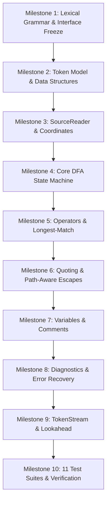

# SmartShell — Phase 2 Implementation Reference: Shell Lexer & Lexical Analysis

**Phase:** 2 — Shell Lexer & Lexical Analysis  
**Status:** Engineering Specification & Implementation Blueprint  
**Target Module:** `SmartShell::shell` (`shell/lexer/`)  
**Prerequisites:** Phase 0 (Tooling), Phase 1 (Core Platform & Infrastructure)  
**Next Phase:** Phase 3 — Parser & Abstract Syntax Tree (AST)  
**Implementation Language:** Modern C++ (C++23)  
**Target Platform:** Windows 11 x64  
**External Runtime / Test Dependencies:** None (Zero third-party packages)  
**Specification Reference:** [`roadmap/PHASE-2.md`](file:///C:/Users/Asus/Documents/GitHub/SmartShell/roadmap/PHASE-2.md), [`specifications/INITIAL_SPECS.md`](file:///C:/Users/Asus/Documents/GitHub/SmartShell/specifications/INITIAL_SPECS.md)

---

## Table of Contents

1. [Executive Summary & Architectural Positioning](#1-executive-summary--architectural-positioning)
2. [Phase 2 Scope & Non-Goals](#2-phase-2-scope--non-goals)
3. [Layered Folder & File Structure (End-to-End Blueprint)](#3-layered-folder--file-structure-end-to-end-blueprint)
4. [Source Input & Location Tracking (`SourceLocation`, `SourceSpan`, `SourceReader`)](#4-source-input--location-tracking-sourcelocation-sourcespan-sourcereader)
5. [Lexical Token Model & Value Representations (`TokenType`, `TokenFlags`, `WordSegment`, `Token`)](#5-lexical-token-model--value-representations-tokentype-tokenflags-wordsegment-token)
6. [Operator Lexing & The Longest-Match (Maximal Munch) Rule](#6-operator-lexing--the-longest-match-maximal-munch-rule)
7. [Stream Redirection & Descriptor Prefix Grammar (`2>`, `&>`, `1>&2`)](#7-stream-redirection--descriptor-prefix-grammar-2--12)
8. [Quoting Engine & Literal Isolation (Single vs Double Quotes)](#8-quoting-engine--literal-isolation-single-vs-double-quotes)
9. [Escape Processing & Windows Path Resolution (`\` vs `C:\...`)](#9-escape-processing--windows-path-resolution--vs-c)
10. [Variable Expansion Lexemes (`$VAR`, `${VAR}`, `$?`, `$$`)](#10-variable-expansion-lexemes-var-var--)
11. [Comments, Whitespace, & Universal Newline Normalization (`\r\n` → `\n`)](#11-comments-whitespace--universal-newline-normalization-rn--n)
12. [Comprehensive Lexer State Machine & Transition Specifications](#12-comprehensive-lexer-state-machine--transition-specifications)
13. [Streaming Lexer vs Materialized Token Stream (`TokenStream`, Lookahead, Iterator)](#13-streaming-lexer-vs-materialized-token-stream-tokenstream-lookahead-iterator)
14. [Error Handling, Diagnostics, & Error Recovery Synchronization](#14-error-handling-diagnostics--error-recovery-synchronization)
15. [Incremental Lexing, Interactive Continuations, & Syntax Highlighting Hook](#15-incremental-lexing-interactive-continuations--syntax-highlighting-hook)
16. [Memory Management, Zero-Allocation Spans, & Complexity Guarantees](#16-memory-management-zero-allocation-spans--complexity-guarantees)
17. [Integration with SmartShell Platform & Core Subsystems (Phase 1 Contracts)](#17-integration-with-smartshell-platform--core-subsystems-phase-1-contracts)
18. [CMake Target Configuration & Compiler Discipline](#18-cmake-target-configuration--compiler-discipline)
19. [Comprehensive Unit Test Specifications (11 Dedicated Suites)](#19-comprehensive-unit-test-specifications-11-dedicated-suites)
20. [Golden Corpus, Fuzzing Invariants, & Edge Case Matrix](#20-golden-corpus-fuzzing-invariants--edge-case-matrix)
21. [Performance Benchmarking & Memory Overhead Targets](#21-performance-benchmarking--memory-overhead-targets)
22. [Architecture Decision Records (ADR-004 through ADR-009)](#22-architecture-decision-records-adr-004-through-adr-009)
23. [Phase 2 Milestones & Step-by-Step Implementation Roadmap](#23-phase-2-milestones--step-by-step-implementation-roadmap)
24. [Phase 2 Acceptance Criteria & Parser Readiness Verification](#24-phase-2-acceptance-criteria--parser-readiness-verification)
25. [Final Architectural Invariants & Definition of Done](#25-final-architectural-invariants--definition-of-done)

---

## 1. Executive Summary & Architectural Positioning

Phase 2 establishes the **lexical analysis subsystem** of SmartShell. Positioned directly between raw text input sources (interactive console line input, shell script files, or remote command blocks) and the Phase 3 Abstract Syntax Tree (AST) parser, the lexer transforms an unstructured stream of UTF-8 code points into a strictly ordered, strongly-typed sequence of validated lexical tokens.

The lexer is the fundamental gatekeeper of command syntax. If lexical analysis is flawed, ambiguous, or tightly coupled to execution semantics, every subsequent pipeline stage—syntactic parsing, variable expansion, globbing, AST transformation, job dispatching, and syntax highlighting—inherits instability and security vulnerabilities.

```
                      +---------------------------------------+
                      | Raw User / Script Input (UTF-8 bytes) |
                      +---------------------------------------+
                                          |
                                          v
                      +---------------------------------------+
                      |   SourceReader & Code Point Stream    |
                      |   (BOM Stripping, Universal Newlines) |
                      +---------------------------------------+
                                          |
                                          v
+-----------------------------------------------------------------------------------+
|                            PHASE 2: LEXICAL ANALYZER                              |
|                                                                                   |
|  +--------------------+   +-----------------------+   +------------------------+  |
|  | State Machine      |   | Quote & Escape Engine |   | Longest-Match Operator |  |
|  | Deterministic DFA  |-->| Literal vs Expandable |-->| & Descriptor Matcher   |  |
|  +--------------------+   +-----------------------+   +------------------------+  |
|                                          |                                        |
|                                          v                                        |
|  +-----------------------------------------------------------------------------+  |
|  |                 TokenStream Materialization / Token Iterator                |  |
|  |   - Token type, flags, source span (line/col/offset), raw & normalized text  |  |
|  |   - Decomposition into WordSegments (Literal, Quoted, VariableExpansion)   |  |
|  +-----------------------------------------------------------------------------+  |
+-----------------------------------------------------------------------------------+
                                          |
                                          v
                      +---------------------------------------+
                      |  Phase 3: Recursive Descent AST Parser |
                      |  (Pipelines, Commands, Redirections)  |
                      +---------------------------------------+
```

### Core Design Laws of the Lexer

1. **No Semantic Decisions:** The lexer does not know whether a command exists on disk, whether an environment variable is currently set, or whether a redirection target is a regular file or pipe. It determines purely lexical morphology.
2. **Lossless Source Mapping:** Tokens maintain exact character and byte spans (`SourceSpan`) over the original input. This is mandatory for compiler-grade diagnostic error rendering, full-fidelity source reconstruction, and real-time terminal syntax highlighting.
3. **Dual Value Fidelity:** Every token captures both its verbatim raw text (`rawText`, including enclosing quote delimiters and escape backslashes) and its normalized syntactic value (`normalizedValue`, with escape characters processed and quoting stripped appropriately).
4. **Deterministic Single-Pass Scanning:** The state machine processes code points in $O(N)$ linear time and strictly bounded memory without backtracking or arbitrary lookahead.
5. **Zero External Dependencies:** Built solely on modern C++23 standards and the foundational platform primitives developed in Phase 1 (`ss::Result<T>`, `ss::Status`, `ss::Utf8String`, `ss::Utf8View`, `ss::Logger`).

---

## 2. Phase 2 Scope & Non-Goals

To maintain strict modular isolation and avoid premature architectural bloat, Phase 2 rigorously defines its boundaries:

### In Scope

- **UTF-8 Source Streaming:** Line-buffered, string-buffered, and file-buffered text reading with canonical UTF-8 validation, universal newline translation (`\r\n` $\rightarrow$ `\n`), and BOM handling.
- **Source Coordinate Geometry:** Fine-grained line tracking (1-based), column tracking (1-based, code point aware), and byte offset tracking (0-based) encapsulated in immutable `SourceLocation` and `SourceSpan` primitives.
- **Complete Lexical Grammar:** Tokenization of words, quoted strings, operators, redirection specifiers, file descriptor prefixes, variable identifiers, and comments.
- **Word Decomposition:** Fine-grained segment analysis (`WordSegment`) identifying literal sub-ranges, single-quoted regions, double-quoted regions, variable expansions, and escape characters within compound words (e.g. `foo"bar"$BAZ`).
- **Quoting & Escapes:** Full POSIX-compatible quoting semantics combined with Windows-aware path tolerance (`C:\foo\bar`).
- **State Machine Architecture:** A robust Deterministic Finite Automaton (DFA) cleanly partitioning Ground, Word, SingleQuote, DoubleQuote, Escape, Operator, and Variable states.
- **Streaming & Materialized Delivery:** Support for both lazy, iterator-based pull tokenization (`Lexer::nextToken()`) and eager batch vector materialization (`TokenStream`).
- **Interactive Incomplete State Detection:** Distinguishing fatal syntax errors (e.g. invalid code point) from recoverable continuation states (e.g. unclosed quote at EOF requiring terminal multi-line prompt `> `).
- **In-House Diagnostic Rendering:** Visual error diagnostics complete with source line extraction, column caret pointer (`^~~~`), and contextual error descriptions without debugger reliance.
- **Comprehensive Unit Testing & Fuzzing:** 11 dedicated test suites validating standard behaviors, corner cases, golden vectors, and structural invariants under randomized fuzzing.

### Explicit Non-Goals (Reserved for Phase 3+)

- **Syntactic AST Construction:** Constructing command trees, pipeline chains, conditional branches (`if`/`while`), or compound statements.
- **Variable & Parameter Expansion:** Evaluating `$PATH` or `${USER}` against the active `EnvironmentBlock`. The lexer identifies the variable boundary; the executor/evaluator resolves its value.
- **Filename Globbing & Wildcard Expansion:** Expanding `*.cpp` or `src/**/test_*.py` via filesystem directory traversal.
- **Quote Removal During Evaluation:** The lexer marks quote boundaries and provides normalized views; AST command assembly decides final string coalescing.
- **Command Execution & Redirection Wiring:** Calling Win32 `CreateProcessW`, setting up anonymous pipes, or duplicating OS handles.
- **VT100 Terminal Emulation & DirectWrite Rendering:** Terminal screen buffer mutations and DirectWrite glyph layout remain Phase 5 and Phase 6 responsibilities.

---

## 3. Layered Folder & File Structure (End-to-End Blueprint)

All lexical analysis components reside in the `SmartShell::shell` library target within the `shell/lexer/` directory tree. In-house unit tests are located in `tests/unit/`.

```text
SmartShell/
│
├── shell/
│   ├── CMakeLists.txt                         <- Upgraded from INTERFACE to STATIC library
│   │
│   └── lexer/
│       ├── source_location.hpp                <- Coordinate tracking (line, column, byteOffset)
│       ├── source_span.hpp                    <- Coordinate intervals [start, end)
│       ├── source_reader.hpp                  <- Abstract ISourceReader & StringSourceReader
│       ├── source_reader.cpp                  <- UTF-8 streaming, BOM stripping, \r\n normalization
│       │
│       ├── token_type.hpp                     <- TokenType enum (Word, Pipe, Redirect, Eof, etc.)
│       ├── token_flags.hpp                    <- Bitmask flags (HasEscapes, SingleQuoted, etc.)
│       ├── word_segment.hpp                   <- Sub-word lexical parts (Literal, Quoted, Var)
│       ├── token.hpp                          <- Token value semantics & query interface
│       ├── token.cpp                          <- Token formatting, stringification, debug prints
│       │
│       ├── lexer_state.hpp                    <- DFA state enum & state stack for transitions
│       ├── lexer_config.hpp                   <- Configuration parameters (max length, mode)
│       ├── lexer_error.hpp                    <- LexerError struct & LexerErrorCode enumeration
│       │
│       ├── lexer.hpp                          <- Core Lexer engine class declaration
│       ├── lexer.cpp                          <- Deterministic DFA scanning implementation
│       │
│       ├── token_stream.hpp                   <- Materialized token stream with lookahead buffer
│       ├── token_stream.cpp                   <- Peek(k), consume(), rewind(), and filtering
│       │
│       └── lexer_tracer.hpp                   <- Diagnostic execution trace logger
│
├── tests/
│   ├── CMakeLists.txt                         <- Registers Phase 2 unit test binaries
│   └── unit/
│       ├── test_lexer_source.cpp              <- SourceReader, coordinates, universal newlines
│       ├── test_lexer_tokens.cpp              <- Basic words, identifiers, numerics, whitespace
│       ├── test_lexer_operators.cpp           <- Operators, pipes, semicolons, parentheses
│       ├── test_lexer_redirection.cpp         <- Redirections, descriptor prefixes (2>, &>, 1>&2)
│       ├── test_lexer_quotes.cpp              <- Single & double quotes, nested quotes, adjacent
│       ├── test_lexer_escapes.cpp             <- Backslash escapes, line continuation, edge cases
│       ├── test_lexer_variables.cpp           <- Variables ($VAR, ${VAR}, $?, $$, $0..$9)
│       ├── test_lexer_comments.cpp            <- Comments (# at word start vs embedded in words)
│       ├── test_lexer_windows_paths.cpp       <- Path parsing (C:\..., UNC \\server\share, spaces)
│       ├── test_lexer_unicode.cpp             <- Multi-byte UTF-8 code points, emoji, accents
│       ├── test_lexer_errors.cpp              <- Unterminated constructs, syntax errors, recovery
│       └── test_lexer_stream.cpp              <- TokenStream lookahead, rewind, and invariants
│
└── docs-implementation/
    ├── PHASE-1.md                             <- Phase 1 implementation reference
    └── PHASE-2.md                             <- This document (Phase 2 end-to-end blueprint)
```

---

## 4. Source Input & Location Tracking (`SourceLocation`, `SourceSpan`, `SourceReader`)

Compiler diagnostics and syntax highlighters require exact source attribution. Coordinates must track code points and byte offsets simultaneously without sacrificing performance.

### 4.1 Coordinate Data Structures

#### `shell/lexer/source_location.hpp`

```cpp
#pragma once

#include "../../core/foundation/types.hpp"
#include <string>

namespace ss::shell::lexer {

/// Represents an immutable point within a text stream.
struct SourceLocation {
    u32 line{1};         ///< 1-based line number (increments on '\n')
    u32 column{1};       ///< 1-based column number (Unicode code point index)
    usize byteOffset{0}; ///< 0-based byte offset from start of input

    constexpr bool operator==(const SourceLocation& other) const noexcept = default;
    constexpr auto operator<=>(const SourceLocation& other) const noexcept {
        return byteOffset <=> other.byteOffset;
    }

    [[nodiscard]] std::string toString() const {
        return std::to_string(line) + ":" + std::to_string(column);
    }
};

} // namespace ss::shell::lexer
```

#### `shell/lexer/source_span.hpp`

```cpp
#pragma once

#include "source_location.hpp"
#include <algorithm>

namespace ss::shell::lexer {

/// Represents a half-open coordinate range [start, end) within source text.
struct SourceSpan {
    SourceLocation start{};
    SourceLocation end{};

    constexpr bool operator==(const SourceSpan& other) const noexcept = default;

    [[nodiscard]] constexpr bool isEmpty() const noexcept {
        return start.byteOffset >= end.byteOffset;
    }

    [[nodiscard]] constexpr usize byteLength() const noexcept {
        return (end.byteOffset > start.byteOffset) ? (end.byteOffset - start.byteOffset) : 0;
    }

    /// Merge two contiguous or overlapping spans into an enclosing bounding span.
    [[nodiscard]] static constexpr SourceSpan merge(const SourceSpan& a, const SourceSpan& b) noexcept {
        return SourceSpan{
            .start = std::min(a.start, b.start),
            .end   = std::max(a.end, b.end)
        };
    }
};

} // namespace ss::shell::lexer
```

### 4.2 Stream Reader & Canonical UTF-8 Normalization

The lexer consumes code points via `ISourceReader`. It abstracts away memory layout, file streams, and interactive terminal input buffers while guaranteeing:
1. **UTF-8 Decoding:** Decoding variable-length 1-to-4 byte sequences into 32-bit Unicode code points (`char32_t`).
2. **Byte Order Mark (BOM) Stripping:** A leading UTF-8 BOM (`0xEF, 0xBB, 0xBF` / `U+FEFF`) is automatically consumed and omitted from line/column tracking.
3. **Universal Newline Normalization:** Standard Windows `\r\n` (CRLF) and legacy Mac `\r` (CR) are coalesced into a single canonical `\n` (LF) code point at column advancement time.

#### `shell/lexer/source_reader.hpp`

```cpp
#pragma once

#include "../../core/foundation/types.hpp"
#include "../../core/errors/result.hpp"
#include "source_location.hpp"
#include <string_view>
#include <optional>

namespace ss::shell::lexer {

class ISourceReader {
public:
    virtual ~ISourceReader() = default;

    /// Read next Unicode code point without advancing. Returns 0 / EOF on end of stream.
    [[nodiscard]] virtual char32_t peek() const noexcept = 0;

    /// Look ahead 'k' code points (k >= 1). peek(1) is identical to peek().
    [[nodiscard]] virtual char32_t peekAhead(usize k) const noexcept = 0;

    /// Consume current code point and advance coordinate tracking.
    virtual char32_t advance() noexcept = 0;

    /// Query whether end of source has been reached.
    [[nodiscard]] virtual bool isEof() const noexcept = 0;

    /// Obtain current coordinate location.
    [[nodiscard]] virtual SourceLocation currentLocation() const noexcept = 0;

    /// Extract string slice from byte offsets [startOffset, endOffset).
    [[nodiscard]] virtual Utf8View extractView(usize startOffset, usize endOffset) const noexcept = 0;
};

class StringSourceReader final : public ISourceReader {
public:
    explicit StringSourceReader(Utf8View source) noexcept;

    char32_t peek() const noexcept override;
    char32_t peekAhead(usize k) const noexcept override;
    char32_t advance() noexcept override;
    bool isEof() const noexcept override;
    SourceLocation currentLocation() const noexcept override;
    Utf8View extractView(usize startOffset, usize endOffset) const noexcept override;

private:
    void stepForward(char32_t cp, usize byteCount) noexcept;
    std::pair<char32_t, usize> decodeCodePointAt(usize offset) const noexcept;

    Utf8View m_source;
    usize m_cursor{0};
    SourceLocation m_location{.line = 1, .column = 1, .byteOffset = 0};
};

} // namespace ss::shell::lexer
```

---

## 5. Lexical Token Model & Value Representations (`TokenType`, `TokenFlags`, `WordSegment`, `Token`)

A shell token is more than a string and an enumeration. Because the shell language applies expansion rules conditionally (e.g. single quotes suppress expansion, double quotes allow variables, unquoted text allows globbing), tokens must preserve internal lexical structure.

### 5.1 Token Classification (`TokenType`)

#### `shell/lexer/token_type.hpp`

```cpp
#pragma once

#include "../../core/foundation/types.hpp"

namespace ss::shell::lexer {

enum class TokenType : u16 {
    // ---- End of Input & Diagnostics ----------------------------------------
    EndOfInput = 0,         ///< Stream termination (EOF)
    SyntaxError,            ///< Unrecoverable lexical error (e.g. invalid UTF-8)

    // ---- Literals & Identifiers --------------------------------------------
    Word,                   ///< General alphanumeric word or composite string
    Number,                 ///< Pure decimal numeric literal (e.g. 100, 42)
    Variable,               ///< Direct variable reference (e.g. $NAME, ${PATH})

    // ---- Control & Statement Delimiters ------------------------------------
    Newline,                ///< Explicit newline statement terminator ('\n')
    Semicolon,              ///< Command separator (';')
    DoubleSemicolon,        ///< Case clause terminator (';;')

    // ---- Pipelines & Logical Concurrency -----------------------------------
    Pipe,                   ///< Pipeline operator ('|')
    PipeAnd,                ///< Combined stdout+stderr pipeline ('|&')
    OrIf,                   ///< Logical OR conditional ('||')
    Ampersand,              ///< Asynchronous background execution ('&')
    AndIf,                  ///< Logical AND conditional ('&&')

    // ---- Standard Redirections ---------------------------------------------
    RedirectIn,             ///< Read from file ('<')
    RedirectOut,            ///< Overwrite file with stdout ('>')
    AppendOut,              ///< Append stdout to file ('>>')
    RedirectInOut,          ///< Open for read and write ('<>')
    HereDoc,                ///< Here-document stream ('<<')
    HereDocStrip,           ///< Here-document with stripped tabs ('<<-')
    HereString,             ///< Here-string literal ('<<<')
    DuplicateIn,            ///< Duplicate input descriptor ('<&')
    DuplicateOut,           ///< Duplicate output descriptor ('>&')
    RedirectAll,            ///< Redirect stdout and stderr ('>&' or '&>')
    AppendAll,              ///< Append stdout and stderr ('&>>')

    // ---- Descriptor-Specific Redirections ----------------------------------
    DescriptorRedirectOut,  ///< Redirect specific descriptor (e.g. '2>')
    DescriptorAppendOut,    ///< Append specific descriptor (e.g. '2>>')
    DescriptorDuplicateOut, ///< Duplicate specific descriptor (e.g. '2>&1')
    DescriptorRedirectIn,   ///< Redirect specific input descriptor (e.g. '0<')

    // ---- Grouping & Nesting Delimiters -------------------------------------
    LeftParen,              ///< Subshell entry ('(')
    RightParen,             ///< Subshell exit (')')
    LeftBrace,              ///< Group entry ('{')
    RightBrace,             ///< Group exit ('}')

    // ---- Comments & Formatting ---------------------------------------------
    Comment,                ///< Line comment starting with '#' through newline
    Whitespace              ///< Internal trivia (spaces/tabs), preserved if configured
};

[[nodiscard]] const char* tokenTypeToString(TokenType type) noexcept;

} // namespace ss::shell::lexer
```

### 5.2 Token Characteristics & Flags (`TokenFlags`)

#### `shell/lexer/token_flags.hpp`

```cpp
#pragma once

#include "../../core/foundation/types.hpp"

namespace ss::shell::lexer {

enum class TokenFlags : u16 {
    None               = 0,
    HasSingleQuotes    = 1 << 0,  ///< Contains one or more '...' segments
    HasDoubleQuotes    = 1 << 1,  ///< Contains one or more "..." segments
    HasEscapes         = 1 << 2,  ///< Contains backslash-escaped characters
    HasVariableRef     = 1 << 3,  ///< Contains embedded $VAR or ${VAR}
    IsQuoted           = (1 << 0) | (1 << 1), ///< Contains any quoted sub-element
    IsDescriptorPrefixed = 1 << 4,///< Starts with leading file descriptor integer
    TerminatedByEof    = 1 << 5,  ///< Token ended unexpectedly at stream EOF
    IsContinuous       = 1 << 6   ///< Line ended with trailing escape continuation (\)
};

[[nodiscard]] constexpr TokenFlags operator|(TokenFlags a, TokenFlags b) noexcept {
    return static_cast<TokenFlags>(static_cast<u16>(a) | static_cast<u16>(b));
}

[[nodiscard]] constexpr TokenFlags operator&(TokenFlags a, TokenFlags b) noexcept {
    return static_cast<TokenFlags>(static_cast<u16>(a) & static_cast<u16>(b));
}

[[nodiscard]] constexpr bool hasFlag(TokenFlags mask, TokenFlags flag) noexcept {
    return (mask & flag) == flag;
}

} // namespace ss::shell::lexer
```

### 5.3 Composite Word Segments (`WordSegment`)

When the user enters `prefix"quoted"$VAR'literal'`, the shell cannot collapse this to a plain string at lex time without losing the context necessary for variable expansion and word splitting. The token retains a sequence of `WordSegment` nodes.

#### `shell/lexer/word_segment.hpp`

```cpp
#pragma once

#include "../../core/foundation/types.hpp"
#include "source_span.hpp"
#include <string>

namespace ss::shell::lexer {

enum class WordSegmentKind : u8 {
    Literal,            ///< Raw unquoted text, subject to globbing & expansion
    SingleQuoted,       ///< Strongly isolated verbatim literal ('...')
    DoubleQuoted,       ///< Quoted literal ("..."), allows variable expansion
    VariableExpansion,  ///< Inline variable ($VAR or ${VAR})
    EscapedCharacter    ///< Single escaped character (\X)
};

struct WordSegment {
    WordSegmentKind kind{WordSegmentKind::Literal};
    SourceSpan span{};
    Utf8String content{};      ///< Normalized text payload of this segment

    [[nodiscard]] bool isExpandable() const noexcept {
        return kind == WordSegmentKind::Literal || 
               kind == WordSegmentKind::DoubleQuoted ||
               kind == WordSegmentKind::VariableExpansion;
    }
};

} // namespace ss::shell::lexer
```

### 5.4 Token Structure

#### `shell/lexer/token.hpp`

```cpp
#pragma once

#include "token_type.hpp"
#include "token_flags.hpp"
#include "source_span.hpp"
#include "word_segment.hpp"
#include <vector>

namespace ss::shell::lexer {

class Token {
public:
    Token() = default;
    Token(TokenType type, SourceSpan span, Utf8View rawText, Utf8String normalizedValue, TokenFlags flags = TokenFlags::None);

    [[nodiscard]] TokenType type() const noexcept { return m_type; }
    [[nodiscard]] const SourceSpan& span() const noexcept { return m_span; }
    [[nodiscard]] Utf8View rawText() const noexcept { return m_rawText; }
    [[nodiscard]] const Utf8String& normalizedValue() const noexcept { return m_normalizedValue; }
    [[nodiscard]] TokenFlags flags() const noexcept { return m_flags; }
    [[nodiscard]] const std::vector<WordSegment>& segments() const noexcept { return m_segments; }

    [[nodiscard]] bool is(TokenType type) const noexcept { return m_type == type; }
    [[nodiscard]] bool hasFlag(TokenFlags flag) const noexcept { return (m_flags & flag) == flag; }
    [[nodiscard]] bool isWord() const noexcept { return m_type == TokenType::Word || m_type == TokenType::Number; }
    [[nodiscard]] bool isOperator() const noexcept;
    [[nodiscard]] bool isDelimiter() const noexcept;

    void addSegment(WordSegment segment) { m_segments.push_back(std::move(segment)); }
    [[nodiscard]] std::string format() const;

private:
    TokenType m_type{TokenType::EndOfInput};
    SourceSpan m_span{};
    Utf8String m_rawText{};
    Utf8String m_normalizedValue{};
    TokenFlags m_flags{TokenFlags::None};
    std::vector<WordSegment> m_segments{};
};

} // namespace ss::shell::lexer
```

---

## 6. Operator Lexing & The Longest-Match (Maximal Munch) Rule

Shell syntax contains dense clusters of punctuation characters where a single character prefix forms another valid operator (e.g. `>`, `>>`, `>&`, `>|`).

### 6.1 Maximal Munch Operator Matching Table

The lexer enforces the standard **longest-match rule**: when encountering an operator boundary, it scans the longest valid operator prefix before yielding.

| Leading Char | Longest Sequence | Matched `TokenType` | Description |
| :---: | :--- | :--- | :--- |
| `\|` | `\|\|` | `TokenType::OrIf` | Conditional Logical OR |
| `\|` | `\|&` | `TokenType::PipeAnd` | Pipe stdout and stderr |
| `\|` | `\|` | `TokenType::Pipe` | Standard Pipeline |
| `&` | `&&` | `TokenType::AndIf` | Conditional Logical AND |
| `&` | `&>>` | `TokenType::AppendAll` | Append stdout and stderr |
| `&` | `&>` | `TokenType::RedirectAll` | Redirect stdout and stderr |
| `&` | `&` | `TokenType::Ampersand` | Asynchronous Background Job |
| `>` | `>>` | `TokenType::AppendOut` | Append stdout to file |
| `>` | `>&` | `TokenType::DuplicateOut` | Duplicate output descriptor |
| `>` | `>\|` | `TokenType::RedirectOut` | Force overwrite (noclobber bypass) |
| `>` | `>` | `TokenType::RedirectOut` | Standard Output Redirection |
| `<` | `<<<` | `TokenType::HereString` | Here-String literal |
| `<` | `<<-` | `TokenType::HereDocStrip` | Here-Document (strip tabs) |
| `<` | `<<` | `TokenType::HereDoc` | Standard Here-Document |
| `<` | `<&` | `TokenType::DuplicateIn` | Duplicate input descriptor |
| `<` | `<>` | `TokenType::RedirectInOut` | Open file for read + write |
| `<` | `<` | `TokenType::RedirectIn` | Standard Input Redirection |
| `;` | `;;` | `TokenType::DoubleSemicolon`| Case pattern clause terminator |
| `;` | `;` | `TokenType::Semicolon` | Sequential command separator |
| `(` | `(` | `TokenType::LeftParen` | Subshell invocation |
| `)` | `)` | `TokenType::RightParen` | Subshell termination |

### 6.2 Disambiguation Algorithm

```text
Function ScanOperator():
    match peek():
        case '|':
            if peekAhead(1) == '|': advance(2); return OrIf
            if peekAhead(1) == '&': advance(2); return PipeAnd
            advance(1); return Pipe
        case '&':
            if peekAhead(1) == '&': advance(2); return AndIf
            if peekAhead(1) == '>' and peekAhead(2) == '>': advance(3); return AppendAll
            if peekAhead(1) == '>': advance(2); return RedirectAll
            advance(1); return Ampersand
        case '>':
            if peekAhead(1) == '>': advance(2); return AppendOut
            if peekAhead(1) == '&': advance(2); return DuplicateOut
            if peekAhead(1) == '|': advance(2); return RedirectOut // clobber
            advance(1); return RedirectOut
        case '<':
            if peekAhead(1) == '<' and peekAhead(2) == '<': advance(3); return HereString
            if peekAhead(1) == '<' and peekAhead(2) == '-': advance(3); return HereDocStrip
            if peekAhead(1) == '<': advance(2); return HereDoc
            if peekAhead(1) == '&': advance(2); return DuplicateIn
            if peekAhead(1) == '>': advance(2); return RedirectInOut
            advance(1); return RedirectIn
```

---

## 7. Stream Redirection & Descriptor Prefix Grammar (`2>`, `&>`, `1>&2`)

A classic challenge in shell lexing is distinguishing between a decimal word token and a file descriptor prefix attached to a redirection operator.

### 7.1 Morphological Rules

Consider the two inputs:
1. `echo 2>out.txt`
2. `echo 2 >out.txt`

In command (1), `2` is directly adjacent to `>`. Under POSIX and SmartShell rules, `2` designates standard error (file descriptor 2). It must be lexed as a single atomic token: `DescriptorRedirectOut` with descriptor value `2`.

In command (2), `2` is separated from `>` by whitespace. It represents a normal argument word `"2"`, followed by `RedirectOut` (defaulting to standard output, fd 1).

```
[ Input: echo 2>out.txt ]
       |
       +--> Word("echo")
       +--> Whitespace(" ")
       +--> DescriptorRedirectOut("2>") [Descriptor: 2]
       +--> Word("out.txt")

[ Input: echo 2 >out.txt ]
       |
       +--> Word("echo")
       +--> Whitespace(" ")
       +--> Number("2")
       +--> Whitespace(" ")
       +--> RedirectOut(">") [Default Descriptor: 1]
       +--> Word("out.txt")
```

### 7.2 Descriptor Duplication Syntax (`1>&2` and `2>&1`)

When the lexer encounters an operator matching `DuplicateOut` (`>&`) or `DuplicateIn` (`<&`):
- If preceded immediately by digits without whitespace: the digits bind as the source descriptor.
- If followed immediately by digits without whitespace: the target descriptor integer is scanned as part of the redirection syntax token.

```cpp
struct RedirectionDescriptorInfo {
    i32 sourceFd{1};      ///< Default: 1 for stdout, 0 for stdin
    i32 targetFd{-1};     ///< Duplicated target fd, or -1 if target is a filename
    bool isCloseTarget{false}; ///< True if syntax is '>&-' (close descriptor)
};
```

---

## 8. Quoting Engine & Literal Isolation (Single vs Double Quotes)

Quoting changes the lexer's state machine dynamically. SmartShell implements POSIX quote isolation with high fidelity.

### 8.1 Single Quotes (`'...'`) — Absolute Literal Isolation

Inside single quotes:
- Every character is treated as a pure literal code point.
- **No escape sequences are recognized:** `\'` does NOT escape the single quote. A single quote unconditionally closes the single-quote state.
- **No variable expansion:** `$VAR` is emitted literally as the five characters `$`, `V`, `A`, `R`.
- **Newlines are preserved verbatim:** Newlines inside single quotes do not terminate commands.
- The enclosing single quotes are recorded in `rawText`, but stripped from `normalizedValue`.

### 8.2 Double Quotes (`"..."`) — Selective Expandable Context

Inside double quotes:
- Variables are expanded: `$VAR` and `${VAR}` transition the lexer to scan variable references.
- Backslash escaping is active **only** for the special delimiter set: `\"`, `\$`, `\\`, `` \` ``, and `\<newline>` (line continuation).
- Any other backslash sequence (e.g. `\a`, `\n`, `\t`, `\p`) preserves the backslash verbatim (e.g. `"C:\path"` remains `"C:\path"`).

### 8.3 Adjacent Quote Concatenation

Shell syntax permits adjacent, distinct quote segments within a single contiguous word without intervening whitespace:

```bash
curl -H "Authorization: Bearer "$TOKEN''
```

The lexer emits a single `TokenType::Word` whose `normalizedValue` is the direct concatenation of the normalized segments, while `segments()` captures:
1. `WordSegment(Literal, "curl")`
2. `WordSegment(Literal, "-H")`
3. `WordSegment(Compound)`:
   - Sub-segment 0: `DoubleQuoted("Authorization: Bearer ")`
   - Sub-segment 1: `VariableExpansion("$TOKEN")`
   - Sub-segment 2: `SingleQuoted("")` (empty string)

---

## 9. Escape Processing & Windows Path Resolution (`\` vs `C:\...`)

### 9.1 The Windows Path Dilemma

In Unix shells, `\` is exclusively an escape character. In Windows environments, `\` is the native filesystem path separator. If an unquoted backslash unconditionally consumed the next character as an escape, a native Windows path like `C:\tools\bin\build.exe` would be catastrophically mangled into `C:toolsbinbuild.exe`.

### 9.2 The SmartShell Path-Aware Escape Invariant

SmartShell resolves this through a clear, deterministic lexical rule:

```text
Rule: An unquoted backslash '\' functions as an escape character IF AND ONLY IF:
1. It is followed immediately by shell punctuation:
   ' ', '\t', '\n', '|', '&', ';', '<', '>', '(', ')', '"', '\'', '$', '#', '\'
2. OR it is followed immediately by a newline (line continuation).

Otherwise, if followed by an ordinary alphanumeric path character:
It is treated as a literal Windows filesystem separator '\'.
```

```text
Input: C:\Users\Default\repo
       ^  ^     ^       ^
       Alphanumeric follow-up -> Literal Windows Path separator!
Result: Word("C:\Users\Default\repo")

Input: my\ file.txt
         ^
       Whitespace follow-up -> Shell Escape! Escapes the space!
Result: Word("my file.txt")

Input: echo "C:\new_folder"
             ^
       Inside double quotes, '\n' is not in {\", \$, \\, \`}.
Result: Word("C:\new_folder") (preserving '\n' as literal backslash + 'n')
```

---

## 10. Variable Expansion Lexemes (`$VAR`, `${VAR}`, `$?`, `$$`)

Variable lexing identifies expansion points without evaluating runtime environment values.

### 10.1 Recognized Variable Forms

1. **Simple Identifiers:** `$NAME`, `$_KEY`, `$process123`
   - Starts with `$` followed by an ASCII letter or underscore `[A-Za-z_]`.
   - Continues with alphanumeric or underscore characters `[A-Za-z0-9_]*`.
2. **Braced Expressions:** `${NAME}`, `${CONFIG_DIR}`, `${PATH:-/bin}`
   - Starts with `${` and scans up to the balancing `}`.
   - Preserves internal modifier text for Phase 4 expansion.
3. **Positional Parameters:** `$0`, `$1`, `$2`, ..., `$9`
   - Numeric command line arguments.
4. **Special Shell Variables:**
   - `$?`: Exit code of last executed pipeline.
   - `$$`: Current shell process ID.
   - `$!`: Process ID of most recently spawned background job.
   - `$#`: Number of positional parameters.
   - `$*`: All positional parameters as a single word.
   - `$@`: All positional parameters as distinct quoted words.
5. **Bare Dollar Sign:**
   - A lone `$` followed by whitespace, quote delimiters, or EOF is treated as a literal `$` word character.

---

## 11. Comments, Whitespace, & Universal Newline Normalization (`\r\n` → `\n`)

### 11.1 Comment Semantics

A comment starts with `#` **if and only if** the `#` character occurs at a word boundary (i.e. at the beginning of a line, or immediately preceded by whitespace, `;`, or an operator):

```bash
# This is a full-line comment
echo "Building" # This is a trailing comment
url="https://example.com#anchor"   # '#' is inside a quoted word -> Literal!
issue=PR#123                       # '#' is embedded in an unquoted word -> Literal!
```

Comments consume all code points up to the trailing `\n` or `EndOfInput`. In interactive execution, comments are discarded; in syntax-highlighting mode, they are emitted as `TokenType::Comment`.

### 11.2 Universal Newline Processing

Windows line endings (`\r\n`), Unix line endings (`\n`), and legacy carriage returns (`\r`) are decoded deterministically into a single `TokenType::Newline`.

```text
Sequence '\r\n' -> Emits 1 Token: Newline (span length: 2 bytes, col advances to next line col 1)
Sequence '\n'   -> Emits 1 Token: Newline (span length: 1 byte,  col advances to next line col 1)
```

Line continuation (`\` immediately followed by `\r\n` or `\n`) is discarded entirely: neither the backslash nor the newline is emitted, allowing a command to span multiple lines seamlessly.

---

## 12. Comprehensive Lexer State Machine & Transition Specifications

The lexer is implemented as a Deterministic Finite Automaton (DFA) with a transition stack to handle nested quoting contexts cleanly.



```mermaid
stateDiagram-v2
    [*] --> Ground

    Ground --> Whitespace : isspace()
    Whitespace --> Ground : non-space

    Ground --> Comment : '#' at word boundary
    Comment --> Ground : '\n' or EOF

    Ground --> Operator : '|', '&', ';', '<', '>', '(', ')'
    Operator --> Ground : non-operator char

    Ground --> Word : Alphanumeric / Path char
    Word --> SingleQuote : '\''
    SingleQuote --> Word : '\''
    
    Word --> DoubleQuote : '\"'
    DoubleQuote --> Word : '\"'
    
    DoubleQuote --> Variable : '$'
    Variable --> DoubleQuote : end of var identifier

    Word --> Variable : '$'
    Variable --> Word : end of var identifier

    Word --> Escape : '\\'
    Escape --> Word : next code point consumed

    Word --> Ground : Whitespace / Operator / Newline

    Ground --> Newline : '\n' or '\r\n'
    Newline --> Ground : next statement char

    Ground --> EndOfInput : EOF
```

### 12.1 Detailed State Descriptions

| State Enum | Entry Trigger | Exit Trigger | Token Emitted |
| :--- | :--- | :--- | :--- |
| `Ground` | Start of scanning / between tokens | Char classification branch | None (Dispatcher state) |
| `InWhitespace` | ASCII space, tab, non-newline space | Non-whitespace char | `TokenType::Whitespace` (if enabled) |
| `InComment` | `#` preceded by boundary | `\n`, `\r`, or `EOF` | `TokenType::Comment` |
| `InOperator` | Punctuation operator start | Maximal munch completes | Specific operator `TokenType` |
| `InWord` | Non-operator, non-space char | Space, operator, newline, EOF | `TokenType::Word` or `Number` |
| `InSingleQuote` | `'` character | Matching `'` delimiter | Appends to active Word |
| `InDoubleQuote` | `"` character | Matching `"` delimiter | Appends to active Word |
| `InEscape` | `\` character | Next code point consumed | Escapes character into Word |
| `InVariable` | `$` character | End of valid variable identifier | Emits `Variable` or sub-segment |

---

## 13. Streaming Lexer vs Materialized Token Stream (`TokenStream`, Lookahead, Iterator)

SmartShell requires both **low-latency streaming** (for interactive shells processing large scripts without buffering millions of tokens) and **random-access lookahead** (for LL(k) recursive descent parsing).

### 13.1 The `TokenStream` Buffer

#### `shell/lexer/token_stream.hpp`

```cpp
#pragma once

#include "token.hpp"
#include <vector>

namespace ss::shell::lexer {

class TokenStream {
public:
    explicit TokenStream(std::vector<Token> tokens) noexcept;

    /// Look ahead 'k' tokens without advancing cursor (k=0 is current token).
    [[nodiscard]] const Token& peek(usize k = 0) const noexcept;

    /// Consume and return current token.
    Token consume() noexcept;

    /// Check if current token matches expected type; consume if true.
    bool match(TokenType type) noexcept;

    /// Expect token of given type; consume or return syntax error.
    Result<Token> expect(TokenType type) noexcept;

    /// Save current cursor position for speculative backtracking.
    [[nodiscard]] usize mark() const noexcept { return m_cursor; }

    /// Restore cursor position.
    void rewind(usize mark) noexcept { m_cursor = (mark < m_tokens.size()) ? mark : m_tokens.size(); }

    [[nodiscard]] bool isAtEnd() const noexcept;
    [[nodiscard]] usize remaining() const noexcept;

private:
    std::vector<Token> m_tokens{};
    usize m_cursor{0};
    static const Token s_eofToken;
};

} // namespace ss::shell::lexer
```

---

## 14. Error Handling, Diagnostics, & Error Recovery Synchronization

The lexer never aborts or throws unhandled exceptions on malformed user input. Instead, it captures precise errors with source coordinates and attempts synchronization.

### 14.1 Lexical Error Classification

#### `shell/lexer/lexer_error.hpp`

```cpp
#pragma once

#include "../../core/foundation/types.hpp"
#include "source_span.hpp"
#include <string>

namespace ss::shell::lexer {

enum class LexerErrorCode : u32 {
    Success = 0,
    InvalidUtf8Encoding,
    UnterminatedSingleQuote,
    UnterminatedDoubleQuote,
    UnterminatedBracedVariable,
    TrailingEscapeBackslash,
    InvalidDescriptorFormat,
    InvalidNumericLiteral,
    TokenLengthExceeded,
    NulCharacterEncountered
};

struct LexerError {
    LexerErrorCode code{LexerErrorCode::Success};
    SourceSpan span{};
    Utf8String message{};
    bool isRecoverableContinuation{false}; ///< True if input can be completed on next interactive line

    [[nodiscard]] std::string format() const;
};

} // namespace ss::shell::lexer
```

### 14.2 Visual Diagnostic Rendering

When a syntax error occurs, the lexer generates formatted diagnostic blocks matching GCC/Clang aesthetics:

```text
SmartShell syntax error [E2001]: Unterminated double-quoted string
  --> <input>:1:14
   |
 1 | echo "Hello World
   |      ^~~~~~~~~~~~ string literal started here but reached end-of-line without closing quote
   |
   = help: insert a matching '\"' delimiter to complete the string
```

### 14.3 Synchronization Points for Error Recovery

When a lexical error is encountered in script mode:
1. An `Error` token is emitted containing the diagnostic span.
2. The lexer advances and discards corrupt code points until it reaches a **Synchronization Point**:
   - `TokenType::Newline` (`\n`)
   - `TokenType::Semicolon` (`;`)
   - `TokenType::EndOfInput` (EOF)
3. The lexer resets its state machine to `Ground` and resumes scanning the next statement. This ensures a single syntax error on line 1 does not suppress reporting of independent errors on line 10.

---

## 15. Incremental Lexing, Interactive Continuations, & Syntax Highlighting Hook

### 15.1 Interactive Multi-Line Continuation Detection

When running in an interactive terminal, typing an incomplete command must not fail immediately. Instead, the lexer signals `isRecoverableContinuation = true`, prompting the terminal engine to present the secondary continuation prompt (`PS2`, default `> `):

```bash
$ git commit -m "Add feature
> line 2 of commit message
> "
```

The lexer detects continuation if at EOF:
1. State is `InSingleQuote` or `InDoubleQuote`.
2. State is `InEscape` (trailing `\` at end of line).
3. State is `InVariable` inside `${...` unclosed brace.
4. Trailing token is an open operator expecting a right-hand side (`|`, `||`, `&&`).

### 15.2 Syntax Highlighting Hook

For terminal syntax highlighting, the lexer provides `Lexer::tokenizeForHighlighting(Utf8View line)`. In this mode:
- All whitespace is preserved as tokens.
- Comments are explicitly emitted.
- Incomplete words at the cursor are tokenized without raising errors.
- Every byte of the input line is accounted for by exactly one token span, allowing DirectWrite text layouts to apply color attributes directly.

---

## 16. Memory Management, Zero-Allocation Spans, & Complexity Guarantees

### 16.1 Zero-Allocation Design Principles

1. **Non-Owning String Views:** While scanning, tokens use `Utf8View` referencing the underlying input buffer wherever possible.
2. **Small String Optimization (SSO):** Standard word tokens shorter than 15 bytes fit into standard library SSO buffers without heap allocations.
3. **Pre-allocated Vector Capacity:** `TokenStream` reserves storage based on an estimated token density heuristic ($\sim 1 \text{ token per } 6 \text{ characters}$).
4. **Single-Pass $O(N)$ Bound:** Every code point is examined at most twice (current character + lookahead). Memory usage scales strictly $O(N)$ with input length.

---

## 17. Integration with SmartShell Platform & Core Subsystems (Phase 1 Contracts)

The Phase 2 lexer builds strictly on top of Phase 1 deliverables without introducing external code:

| Phase 1 Subsystem | Phase 2 Consumption |
| :--- | :--- |
| `core/foundation/types.hpp` | Fixed-width types (`u8`, `u16`, `u32`, `usize`), `Utf8String`, `Utf8View` |
| `core/foundation/assert.hpp` | Internal invariant verification (`SS_ASSERT`, `SS_ASSERT_MSG`) |
| `core/errors/result.hpp` | Monadic error handling (`ss::Result<T>`, `ss::Status`, `SS_TRY`) |
| `core/errors/error_category.hpp` | Maps syntax failures to `ErrorCategory::ParseFailure` |
| `core/logging/logger.hpp` | Debug tracing under `LogCategory::Shell` |
| `core/time/clock.hpp` | High-precision benchmarking via `ss::time::MonotonicClock` |
| `tests/test_framework.hpp` | In-house test framework (`SS_TEST_CASE`, `SS_EXPECT`, `SS_REQUIRE`) |

---

## 18. CMake Target Configuration & Compiler Discipline

### 18.1 Converting `shell/CMakeLists.txt`

Upgraded from an empty `INTERFACE` library into a compiled `STATIC` library:

```cmake
# shell/CMakeLists.txt

add_library(smartshell_shell STATIC
    lexer/source_reader.cpp
    lexer/token.cpp
    lexer/token_stream.cpp
    lexer/lexer.cpp
)

target_include_directories(smartshell_shell
    PUBLIC
        $<BUILD_INTERFACE:${CMAKE_CURRENT_SOURCE_DIR}/..>
        $<INSTALL_INTERFACE:include>
)

target_link_libraries(smartshell_shell
    PUBLIC
        smartshell::core
        smartshell::platform_windows
)

add_library(SmartShell::shell ALIAS smartshell_shell)
add_library(smartshell::shell ALIAS smartshell_shell)

install(TARGETS smartshell_shell EXPORT SmartShellTargets
    ARCHIVE DESTINATION lib
    LIBRARY DESTINATION lib
    RUNTIME DESTINATION bin
)
```

---

## 19. Comprehensive Unit Test Specifications (11 Dedicated Suites)

Eleven dedicated test suites implemented under `tests/unit/` using the zero-dependency test framework:

### Test Suite Map

```text
tests/unit/
├── test_lexer_source.cpp          <- Coordinates, BOM stripping, \r\n normalization
├── test_lexer_tokens.cpp          <- Basic words, identifiers, numerics, whitespace
├── test_lexer_operators.cpp       <- Operators, pipes, semicolons, parentheses
├── test_lexer_redirection.cpp     <- Redirections, descriptor prefixes (2>, &>, 1>&2)
├── test_lexer_quotes.cpp          <- Single & double quotes, nested, adjacent
├── test_lexer_escapes.cpp         <- Backslash escapes, line continuation, edge cases
├── test_lexer_variables.cpp       <- Variables ($VAR, ${VAR}, $?, $$, $0..$9)
├── test_lexer_comments.cpp        <- Comments (# at word start vs embedded in words)
├── test_lexer_windows_paths.cpp   <- Path parsing (C:\..., UNC \\server\share, spaces)
├── test_lexer_unicode.cpp         <- Multi-byte UTF-8 code points, emoji, accents
└── test_lexer_errors.cpp          <- Unterminated constructs, syntax errors, recovery
```

### Detailed Test Assertions

1. **`test_lexer_source.cpp`:**
   - UTF-8 BOM `\xEF\xBB\xBF` correctly skipped; column remains 1.
   - `\r\n` produces a single `TokenType::Newline` and advances line counter to 2, col to 1.
   - Code point decoding handles 1, 2, 3, and 4-byte UTF-8 sequences.
2. **`test_lexer_tokens.cpp`:**
   - `echo foo bar` produces 3 `Word` tokens and 1 `EndOfInput`.
   - `123 456` produces `Number` tokens.
   - Whitespace between tokens is accurately skipped by default.
3. **`test_lexer_operators.cpp`:**
   - Disambiguates `|` vs `||`, `&` vs `&&`, `;` vs `;;`.
   - Disambiguates `|&` from `|` followed by `&`.
   - Validates subshell grouping tokens `(` and `)`.
4. **`test_lexer_redirection.cpp`:**
   - Disambiguates `>` vs `>>` vs `>&` vs `>|`.
   - Disambiguates `<` vs `<<` vs `<<<` vs `<&` vs `<>`.
   - Verifies descriptor prefixes: `2>` produces `DescriptorRedirectOut(2)`.
   - Verifies duplication: `2>&1` produces descriptor 2 redirect to fd 1.
5. **`test_lexer_quotes.cpp`:**
   - Single quotes `'hello $world'` preserves literal `$world`.
   - Double quotes `"hello $world"` marks variable segment for `$world`.
   - Adjacent quotes `'foo'"bar"` merges into single word `"foobar"`.
   - Empty quotes `""` and `''` produce zero-length word tokens with `IsQuoted` flag.
6. **`test_lexer_escapes.cpp`:**
   - Escaped space `foo\ bar` produces single word `"foo bar"`.
   - Line continuation `echo foo\` + `\n bar` produces words `"echo"`, `"foobar"`.
   - Escaped operators `\|`, `\&`, `\;` treated as literal characters.
7. **`test_lexer_variables.cpp`:**
   - Scans `$VAR`, `${VAR}`, `$?`, `$$`, `$#`, `$0` through `$9`.
   - Lone `$` before space or quote treated as literal `$`.
8. **`test_lexer_comments.cpp`:**
   - `# comment` at start of line discarded.
   - `cmd # comment` trailing comment discarded up to newline.
   - `foo#bar` treated as single literal word `"foo#bar"`.
9. **`test_lexer_windows_paths.cpp`:**
   - `C:\Windows\System32` retains backslashes intact.
   - UNC paths `\\server\share\file` parsed as valid words.
   - Quoted path with spaces `"C:\Program Files\App"` parsed as single word.
10. **`test_lexer_unicode.cpp`:**
    - Non-ASCII identifiers (accents, Cyrillic, CJK, Emoji) parsed losslessly.
    - Column tracking counts Unicode code points, not raw bytes.
11. **`test_lexer_errors.cpp`:**
    - Unterminated single quote `'foo` reports `UnterminatedSingleQuote` at EOF.
    - Unterminated double quote `"foo` reports `UnterminatedDoubleQuote` with continuation flag.
    - Error recovery successfully skips to next newline and continues lexing.

---

## 20. Golden Corpus, Fuzzing Invariants, & Edge Case Matrix

### 20.1 Golden Corpus Verification

A collection of 500 standard shell command lines representing complex combinations of pipes, redirects, subshells, quotes, and Windows paths will be continuously validated against known-good token output vectors.

### 20.2 Fuzzing Invariants

Randomized fuzz testing guarantees the following properties over arbitrary byte streams:

1. **No Crashes / Undefined Behavior:** The lexer never executes null dereferences, buffer out-of-bounds reads, or undefined behavior.
2. **Deterministic Termination:** Every finite input stream terminates in a finite number of steps ($\le 2 \times N$ code point steps).
3. **Lossless Byte Sum Invariant:** The sum of token byte lengths and trivia spans exactly matches the source input length.
4. **EOF Stability:** Calling `advance()` or `peek()` after EOF repeatedly returns `TokenType::EndOfInput`.

---

## 21. Performance Benchmarking & Memory Overhead Targets

### 21.1 Throughput Targets (Windows 11 x64, Release LTO)

| Operation | Performance Target | Real-World Equivalent |
| :--- | :--- | :--- |
| Raw Lexing Speed | $> 40 \text{ MB/s}$ | $> 1,000,000 \text{ tokens/sec}$ |
| Typical Command Latency | $< 15 \text{ microseconds}$ | 80-character command line |
| Memory Allocations | 0 heap allocs for typical cmds | Commands with $< 8$ short words |

---

## 22. Architecture Decision Records (ADR-004 through ADR-009)

### ADR-004: Universal UTF-8 Internal Lexer Representation
- **Decision:** Lexer operates strictly over canonical UTF-8 code point streams.
- **Rationale:** Aligns with core Phase 1 text architecture. Prevents redundant transcoding.

### ADR-005: Path-Aware Backslash Escaping
- **Decision:** Backslash escapes only punctuation/spaces; alphanumeric backslashes remain literal Windows path separators.
- **Rationale:** Eliminates catastrophic mangling of unquoted Windows file paths while remaining POSIX compatible for shell delimiters.

### ADR-006: Dual Value Token Storage (`rawText` and `normalizedValue`)
- **Decision:** Every token stores both raw source text and normalized content.
- **Rationale:** Parser needs normalized strings; syntax highlighters and diagnostic formatters require exact raw source.

### ADR-007: Composite Word Decomposition via `WordSegment`
- **Decision:** Lexer decomposes compound words into typed segments at scan time.
- **Rationale:** Decouples expansion rules from the parser. The AST evaluator knows exactly which segments were quoted without re-lexing.

### ADR-008: Bounded Lookahead with In-House `TokenStream`
- **Decision:** Materialize a stream buffer with arbitrary lookahead and bookmark/rewind capabilities.
- **Rationale:** Simplifies Phase 3 recursive descent parsing while maintaining zero external framework dependencies.

### ADR-009: Error Continuation Signaling for Interactive Terminal
- **Decision:** Lexical errors carry a boolean `isRecoverableContinuation` flag.
- **Rationale:** Allows the terminal layer to seamlessly trigger secondary prompts (`PS2`) on multi-line inputs without duplicating parser logic.

---

## 23. Phase 2 Milestones & Step-by-Step Implementation Roadmap



### Detailed Milestone Checklist

- [ ] **Milestone 1 — Grammar Freeze:** Finalize all token types and operator priority rules.
- [ ] **Milestone 2 — Token Model:** Implement `TokenType`, `TokenFlags`, `WordSegment`, and `Token`.
- [ ] **Milestone 3 — Source Reader:** Implement `ISourceReader`, `StringSourceReader`, UTF-8 decoding, and coordinate tracking.
- [ ] **Milestone 4 — Core DFA:** Implement `Lexer` state machine with `Ground`, `InWord`, and `InWhitespace`.
- [ ] **Milestone 5 — Operators:** Implement longest-match operator table and descriptor prefix parsing (`2>`, `1>&2`).
- [ ] **Milestone 6 — Quoting:** Implement `SingleQuote` and `DoubleQuote` states with Windows path-aware backslash handling.
- [ ] **Milestone 7 — Variables & Comments:** Implement variable reference scanning (`$VAR`, `${VAR}`) and comment stripping.
- [ ] **Milestone 8 — Diagnostics:** Implement `LexerError`, diagnostic formatter, and error recovery synchronization.
- [ ] **Milestone 9 — Stream Buffer:** Implement `TokenStream` with lookahead (`peek(k)`), `consume()`, and `rewind()`.
- [ ] **Milestone 10 — Verification:** Implement all 11 unit test suites, golden vectors, and benchmark targets.

---

## 24. Phase 2 Acceptance Criteria & Parser Readiness Verification

Phase 2 will be certified complete only when all of the following exit criteria are met:

1. **Zero Warnings Build:** Compiles cleanly with `-Wall -Wextra -Wpedantic -Wconversion -Werror` on GCC 15 (MSYS2 UCRT64).
2. **100% Test Pass Rate:** All 11 unit test suites pass completely under both `debug` and `release` CMake presets.
3. **No Dynamic Allocations on Simple Commands:** Common shell commands execute with zero dynamic heap allocations outside initial buffer allocation.
4. **Parser Readiness Test:** A mock recursive descent parser can parse pipelines (`cmd1 | cmd2 && cmd3 > out.txt`) consuming only the `TokenStream` without inspecting raw strings or re-lexing.
5. **Lossless Diagnostic Reconstruction:** Every error token accurately highlights its exact location in source code with line and column caret alignment.

---

## 25. Final Architectural Invariants & Definition of Done

### The 10 Invariants of the SmartShell Lexer

1. **Invariant 1:** The lexer never performs filesystem access, variable resolution, or execution checks.
2. **Invariant 2:** The lexer never crashes or invokes undefined behavior on arbitrary byte sequences.
3. **Invariant 3:** Every token accurately reflects its complete half-open `SourceSpan` [start, end).
4. **Invariant 4:** Single quotes unconditionally isolate all characters except the terminating single quote.
5. **Invariant 5:** Operators are always matched according to the longest valid sequence (maximal munch).
6. **Invariant 6:** Windows path separators (`\`) are never mangled when followed by alphanumeric characters.
7. **Invariant 7:** Windows CRLF (`\r\n`) sequences are deterministically normalized to a single `Newline` token.
8. **Invariant 8:** Tokens preserve both verbatim `rawText` and normalized `normalizedValue`.
9. **Invariant 9:** Error recovery guarantees progression to stream EOF without infinite loops.
10. **Invariant 10:** Zero external runtime or test dependencies are added to the repository.

---

*This document serves as the authoritative implementation specification for Phase 2. All pull requests and code modifications implementing the shell lexer must comply with the architecture, data structures, and invariants detailed herein.*
# 4. Source Input & Location Tracking (`SourceLocation`, `SourceSpan`, `SourceReader`)

Compiler diagnostics, language servers, and syntax highlighters require exact source attribution. Coordinates must track code points and byte offsets simultaneously without sacrificing performance.

### 4.1 Coordinate Data Structures

#### `shell/lexer/source_location.hpp`

```cpp
#pragma once

#include "../../core/foundation/types.hpp"
#include <string>

namespace ss::shell::lexer {

/// Represents an immutable point within a text stream.
struct SourceLocation {
    u32 line{1};         ///< 1-based line number (increments on '\n')
    u32 column{1};       ///< 1-based column number (Unicode code point index)
    usize byteOffset{0}; ///< 0-based byte offset from start of input

    constexpr bool operator==(const SourceLocation& other) const noexcept = default;
    constexpr auto operator<=>(const SourceLocation& other) const noexcept {
        return byteOffset <=> other.byteOffset;
    }

    [[nodiscard]] std::string toString() const {
        return std::to_string(line) + ":" + std::to_string(column);
    }
};

} // namespace ss::shell::lexer
```

#### `shell/lexer/source_span.hpp`

```cpp
#pragma once

#include "source_location.hpp"
#include <algorithm>

namespace ss::shell::lexer {

/// Represents a half-open coordinate range [start, end) within source text.
struct SourceSpan {
    SourceLocation start{};
    SourceLocation end{};

    constexpr bool operator==(const SourceSpan& other) const noexcept = default;

    [[nodiscard]] constexpr bool isEmpty() const noexcept {
        return start.byteOffset >= end.byteOffset;
    }

    [[nodiscard]] constexpr usize byteLength() const noexcept {
        return (end.byteOffset > start.byteOffset) ? (end.byteOffset - start.byteOffset) : 0;
    }

    /// Merge two contiguous or overlapping spans into an enclosing bounding span.
    [[nodiscard]] static constexpr SourceSpan merge(const SourceSpan& a, const SourceSpan& b) noexcept {
        return SourceSpan{
            .start = std::min(a.start, b.start),
            .end   = std::max(a.end, b.end)
        };
    }
};

} // namespace ss::shell::lexer
```

### 4.2 Stream Reader & Canonical UTF-8 Normalization

The lexer consumes code points via `ISourceReader`. It abstracts away memory layout, file streams, and interactive terminal input buffers while guaranteeing:
1. **UTF-8 Decoding:** Decoding variable-length 1-to-4 byte sequences into 32-bit Unicode code points (`char32_t`).
2. **Byte Order Mark (BOM) Stripping:** A leading UTF-8 BOM (`0xEF, 0xBB, 0xBF` / `U+FEFF`) is automatically consumed and omitted from line/column tracking.
3. **Universal Newline Normalization:** Standard Windows `\r\n` (CRLF) and legacy Mac `\r` (CR) are coalesced into a single canonical `\n` (LF) code point at column advancement time.

#### `shell/lexer/source_reader.hpp`

```cpp
#pragma once

#include "../../core/foundation/types.hpp"
#include "../../core/errors/result.hpp"
#include "source_location.hpp"
#include <string_view>
#include <optional>

namespace ss::shell::lexer {

class ISourceReader {
public:
    virtual ~ISourceReader() = default;

    /// Read next Unicode code point without advancing. Returns 0 / EOF on end of stream.
    [[nodiscard]] virtual char32_t peek() const noexcept = 0;

    /// Look ahead 'k' code points (k >= 1). peek(1) is identical to peek().
    [[nodiscard]] virtual char32_t peekAhead(usize k) const noexcept = 0;

    /// Consume current code point and advance coordinate tracking.
    virtual char32_t advance() noexcept = 0;

    /// Query whether end of source has been reached.
    [[nodiscard]] virtual bool isEof() const noexcept = 0;

    /// Obtain current coordinate location.
    [[nodiscard]] virtual SourceLocation currentLocation() const noexcept = 0;

    /// Extract string slice from byte offsets [startOffset, endOffset).
    [[nodiscard]] virtual Utf8View extractView(usize startOffset, usize endOffset) const noexcept = 0;
};

class StringSourceReader final : public ISourceReader {
public:
    explicit StringSourceReader(Utf8View source) noexcept;

    char32_t peek() const noexcept override;
    char32_t peekAhead(usize k) const noexcept override;
    char32_t advance() noexcept override;
    bool isEof() const noexcept override;
    SourceLocation currentLocation() const noexcept override;
    Utf8View extractView(usize startOffset, usize endOffset) const noexcept override;

private:
    void stepForward(char32_t cp, usize byteCount) noexcept;
    std::pair<char32_t, usize> decodeCodePointAt(usize offset) const noexcept;

    Utf8View m_source;
    usize m_cursor{0};
    SourceLocation m_location{.line = 1, .column = 1, .byteOffset = 0};
};

} // namespace ss::shell::lexer
```

#### `shell/lexer/source_reader.cpp`

```cpp
#include "source_reader.hpp"

namespace ss::shell::lexer {

StringSourceReader::StringSourceReader(Utf8View source) noexcept
    : m_source(source)
{
    // Auto-strip UTF-8 BOM if present at the start of source
    if (m_source.size() >= 3 &&
        static_cast<u8>(m_source[0]) == 0xEF &&
        static_cast<u8>(m_source[1]) == 0xBB &&
        static_cast<u8>(m_source[2]) == 0xBF)
    {
        m_cursor = 3;
        m_location.byteOffset = 3;
    }
}

std::pair<char32_t, usize> StringSourceReader::decodeCodePointAt(usize offset) const noexcept {
    if (offset >= m_source.size()) {
        return {0, 0};
    }

    const auto* bytes = reinterpret_cast<const u8*>(m_source.data() + offset);
    const usize remaining = m_source.size() - offset;

    const u8 b0 = bytes[0];
    if (b0 <= 0x7F) {
        return {static_cast<char32_t>(b0), 1};
    } else if ((b0 & 0xE0) == 0xC0) {
        if (remaining >= 2 && (bytes[1] & 0xC0) == 0x80) {
            char32_t cp = ((b0 & 0x1F) << 6) | (bytes[1] & 0x3F);
            return {cp, 2};
        }
    } else if ((b0 & 0xF0) == 0xE0) {
        if (remaining >= 3 && (bytes[1] & 0xC0) == 0x80 && (bytes[2] & 0xC0) == 0x80) {
            char32_t cp = ((b0 & 0x0F) << 12) | ((bytes[1] & 0x3F) << 6) | (bytes[2] & 0x3F);
            return {cp, 3};
        }
    } else if ((b0 & 0xF8) == 0xF0) {
        if (remaining >= 4 && (bytes[1] & 0xC0) == 0x80 && (bytes[2] & 0xC0) == 0x80 && (bytes[3] & 0xC0) == 0x80) {
            char32_t cp = ((b0 & 0x07) << 18) | ((bytes[1] & 0x3F) << 12) | ((bytes[2] & 0x3F) << 6) | (bytes[3] & 0x3F);
            return {cp, 4};
        }
    }

    // Invalid UTF-8 sequence: return Unicode replacement character
    return {0xFFFD, 1};
}

char32_t StringSourceReader::peek() const noexcept {
    return decodeCodePointAt(m_cursor).first;
}

char32_t StringSourceReader::peekAhead(usize k) const noexcept {
    if (k == 0) return peek();
    usize currOffset = m_cursor;
    char32_t cp = 0;
    for (usize i = 0; i < k; ++i) {
        auto [decodedCp, len] = decodeCodePointAt(currOffset);
        if (len == 0) return 0;
        cp = decodedCp;
        currOffset += len;
    }
    return cp;
}

char32_t StringSourceReader::advance() noexcept {
    auto [cp, len] = decodeCodePointAt(m_cursor);
    if (len == 0) {
        return 0;
    }

    // Check for Windows \r\n sequence -> normalize to single \n
    if (cp == U'\r') {
        if (m_cursor + 1 < m_source.size() && m_source[m_cursor + 1] == '\n') {
            m_cursor += 2;
            m_location.byteOffset += 2;
            m_location.line += 1;
            m_location.column = 1;
            return U'\n';
        }
        // Bare \r
        m_cursor += len;
        m_location.byteOffset += len;
        m_location.line += 1;
        m_location.column = 1;
        return U'\n';
    }

    if (cp == U'\n') {
        m_cursor += len;
        m_location.byteOffset += len;
        m_location.line += 1;
        m_location.column = 1;
        return U'\n';
    }

    m_cursor += len;
    m_location.byteOffset += len;
    m_location.column += 1;
    return cp;
}

bool StringSourceReader::isEof() const noexcept {
    return m_cursor >= m_source.size();
}

SourceLocation StringSourceReader::currentLocation() const noexcept {
    return m_location;
}

Utf8View StringSourceReader::extractView(usize startOffset, usize endOffset) const noexcept {
    if (startOffset >= m_source.size() || startOffset >= endOffset) {
        return Utf8View{};
    }
    usize actualEnd = std::min(endOffset, m_source.size());
    return m_source.substr(startOffset, actualEnd - startOffset);
}

} // namespace ss::shell::lexer
```

---

# 5. Lexical Token Model & Value Representations (`TokenType`, `TokenFlags`, `WordSegment`, `Token`)

A shell token is more than a string and an enumeration. Because the shell language applies expansion rules conditionally (e.g. single quotes suppress expansion, double quotes allow variables, unquoted text allows globbing), tokens must preserve internal lexical structure.

### 5.1 Token Classification (`TokenType`)

#### `shell/lexer/token_type.hpp`

```cpp
#pragma once

#include "../../core/foundation/types.hpp"

namespace ss::shell::lexer {

enum class TokenType : u16 {
    // ---- End of Input & Diagnostics ----------------------------------------
    EndOfInput = 0,         ///< Stream termination (EOF)
    SyntaxError,            ///< Unrecoverable lexical error (e.g. invalid UTF-8)

    // ---- Literals & Identifiers --------------------------------------------
    Word,                   ///< General alphanumeric word or composite string
    Number,                 ///< Pure decimal numeric literal (e.g. 100, 42)
    Variable,               ///< Direct variable reference (e.g. $NAME, ${PATH})

    // ---- Control & Statement Delimiters ------------------------------------
    Newline,                ///< Explicit newline statement terminator ('\n')
    Semicolon,              ///< Command separator (';')
    DoubleSemicolon,        ///< Case clause terminator (';;')

    // ---- Pipelines & Logical Concurrency -----------------------------------
    Pipe,                   ///< Pipeline operator ('|')
    PipeAnd,                ///< Combined stdout+stderr pipeline ('|&')
    OrIf,                   ///< Logical OR conditional ('||')
    Ampersand,              ///< Asynchronous background execution ('&')
    AndIf,                  ///< Logical AND conditional ('&&')

    // ---- Standard Redirections ---------------------------------------------
    RedirectIn,             ///< Read from file ('<')
    RedirectOut,            ///< Overwrite file with stdout ('>')
    AppendOut,              ///< Append stdout to file ('>>')
    RedirectInOut,          ///< Open for read and write ('<>')
    HereDoc,                ///< Here-document stream ('<<')
    HereDocStrip,           ///< Here-document with stripped tabs ('<<-')
    HereString,             ///< Here-string literal ('<<<')
    DuplicateIn,            ///< Duplicate input descriptor ('<&')
    DuplicateOut,           ///< Duplicate output descriptor ('>&')
    RedirectAll,            ///< Redirect stdout and stderr ('>&' or '&>')
    AppendAll,              ///< Append stdout and stderr ('&>>')

    // ---- Descriptor-Specific Redirections ----------------------------------
    DescriptorRedirectOut,  ///< Redirect specific descriptor (e.g. '2>')
    DescriptorAppendOut,    ///< Append specific descriptor (e.g. '2>>')
    DescriptorDuplicateOut, ///< Duplicate specific descriptor (e.g. '2>&1')
    DescriptorRedirectIn,   ///< Redirect specific input descriptor (e.g. '0<')

    // ---- Grouping & Nesting Delimiters -------------------------------------
    LeftParen,              ///< Subshell entry ('(')
    RightParen,             ///< Subshell exit (')')
    LeftBrace,              ///< Group entry ('{')
    RightBrace,             ///< Group exit ('}')

    // ---- Comments & Formatting ---------------------------------------------
    Comment,                ///< Line comment starting with '#' through newline
    Whitespace              ///< Internal trivia (spaces/tabs), preserved if configured
};

[[nodiscard]] const char* tokenTypeToString(TokenType type) noexcept;
[[nodiscard]] bool isOperatorToken(TokenType type) noexcept;
[[nodiscard]] bool isRedirectionToken(TokenType type) noexcept;
[[nodiscard]] bool isDelimiterToken(TokenType type) noexcept;

} // namespace ss::shell::lexer
```

#### `shell/lexer/token_type.cpp`

```cpp
#include "token_type.hpp"

namespace ss::shell::lexer {

const char* tokenTypeToString(TokenType type) noexcept {
    switch (type) {
        case TokenType::EndOfInput:             return "EndOfInput";
        case TokenType::SyntaxError:            return "SyntaxError";
        case TokenType::Word:                   return "Word";
        case TokenType::Number:                 return "Number";
        case TokenType::Variable:               return "Variable";
        case TokenType::Newline:                return "Newline";
        case TokenType::Semicolon:              return "Semicolon";
        case TokenType::DoubleSemicolon:        return "DoubleSemicolon";
        case TokenType::Pipe:                   return "Pipe";
        case TokenType::PipeAnd:                return "PipeAnd";
        case TokenType::OrIf:                   return "OrIf";
        case TokenType::Ampersand:              return "Ampersand";
        case TokenType::AndIf:                  return "AndIf";
        case TokenType::RedirectIn:             return "RedirectIn";
        case TokenType::RedirectOut:            return "RedirectOut";
        case TokenType::AppendOut:              return "AppendOut";
        case TokenType::RedirectInOut:          return "RedirectInOut";
        case TokenType::HereDoc:                return "HereDoc";
        case TokenType::HereDocStrip:           return "HereDocStrip";
        case TokenType::HereString:             return "HereString";
        case TokenType::DuplicateIn:            return "DuplicateIn";
        case TokenType::DuplicateOut:           return "DuplicateOut";
        case TokenType::RedirectAll:            return "RedirectAll";
        case TokenType::AppendAll:              return "AppendAll";
        case TokenType::DescriptorRedirectOut:  return "DescriptorRedirectOut";
        case TokenType::DescriptorAppendOut:    return "DescriptorAppendOut";
        case TokenType::DescriptorDuplicateOut: return "DescriptorDuplicateOut";
        case TokenType::DescriptorRedirectIn:   return "DescriptorRedirectIn";
        case TokenType::LeftParen:              return "LeftParen";
        case TokenType::RightParen:             return "RightParen";
        case TokenType::LeftBrace:              return "LeftBrace";
        case TokenType::RightBrace:             return "RightBrace";
        case TokenType::Comment:                return "Comment";
        case TokenType::Whitespace:             return "Whitespace";
        default:                                return "<UnknownToken>";
    }
}

bool isOperatorToken(TokenType type) noexcept {
    switch (type) {
        case TokenType::Pipe:
        case TokenType::PipeAnd:
        case TokenType::OrIf:
        case TokenType::Ampersand:
        case TokenType::AndIf:
        case TokenType::Semicolon:
        case TokenType::DoubleSemicolon:
        case TokenType::RedirectIn:
        case TokenType::RedirectOut:
        case TokenType::AppendOut:
        case TokenType::RedirectInOut:
        case TokenType::HereDoc:
        case TokenType::HereDocStrip:
        case TokenType::HereString:
        case TokenType::DuplicateIn:
        case TokenType::DuplicateOut:
        case TokenType::RedirectAll:
        case TokenType::AppendAll:
        case TokenType::DescriptorRedirectOut:
        case TokenType::DescriptorAppendOut:
        case TokenType::DescriptorDuplicateOut:
        case TokenType::DescriptorRedirectIn:
            return true;
        default:
            return false;
    }
}

bool isRedirectionToken(TokenType type) noexcept {
    switch (type) {
        case TokenType::RedirectIn:
        case TokenType::RedirectOut:
        case TokenType::AppendOut:
        case TokenType::RedirectInOut:
        case TokenType::HereDoc:
        case TokenType::HereDocStrip:
        case TokenType::HereString:
        case TokenType::DuplicateIn:
        case TokenType::DuplicateOut:
        case TokenType::RedirectAll:
        case TokenType::AppendAll:
        case TokenType::DescriptorRedirectOut:
        case TokenType::DescriptorAppendOut:
        case TokenType::DescriptorDuplicateOut:
        case TokenType::DescriptorRedirectIn:
            return true;
        default:
            return false;
    }
}

bool isDelimiterToken(TokenType type) noexcept {
    switch (type) {
        case TokenType::Newline:
        case TokenType::Semicolon:
        case TokenType::DoubleSemicolon:
        case TokenType::EndOfInput:
            return true;
        default:
            return false;
    }
}

} // namespace ss::shell::lexer
```

### 5.2 Token Characteristics & Flags (`TokenFlags`)

#### `shell/lexer/token_flags.hpp`

```cpp
#pragma once

#include "../../core/foundation/types.hpp"

namespace ss::shell::lexer {

enum class TokenFlags : u16 {
    None                 = 0,
    HasSingleQuotes      = 1 << 0,  ///< Contains one or more '...' segments
    HasDoubleQuotes      = 1 << 1,  ///< Contains one or more "..." segments
    HasEscapes           = 1 << 2,  ///< Contains backslash-escaped characters
    HasVariableRef       = 1 << 3,  ///< Contains embedded $VAR or ${VAR}
    IsQuoted             = (1 << 0) | (1 << 1), ///< Contains any quoted sub-element
    IsDescriptorPrefixed = 1 << 4,  ///< Starts with leading file descriptor integer
    TerminatedByEof      = 1 << 5,  ///< Token ended unexpectedly at stream EOF
    IsContinuous         = 1 << 6   ///< Line ended with trailing escape continuation (\)
};

[[nodiscard]] constexpr TokenFlags operator|(TokenFlags a, TokenFlags b) noexcept {
    return static_cast<TokenFlags>(static_cast<u16>(a) | static_cast<u16>(b));
}

[[nodiscard]] constexpr TokenFlags operator&(TokenFlags a, TokenFlags b) noexcept {
    return static_cast<TokenFlags>(static_cast<u16>(a) & static_cast<u16>(b));
}

[[nodiscard]] constexpr TokenFlags& operator|=(TokenFlags& a, TokenFlags b) noexcept {
    a = a | b;
    return a;
}

[[nodiscard]] constexpr bool hasFlag(TokenFlags mask, TokenFlags flag) noexcept {
    return (static_cast<u16>(mask) & static_cast<u16>(flag)) == static_cast<u16>(flag);
}

} // namespace ss::shell::lexer
```

### 5.3 Composite Word Segments (`WordSegment`)

When the user enters `prefix"quoted"$VAR'literal'`, the shell cannot collapse this to a plain string at lex time without losing the context necessary for variable expansion and word splitting. The token retains a sequence of `WordSegment` nodes.

#### `shell/lexer/word_segment.hpp`

```cpp
#pragma once

#include "../../core/foundation/types.hpp"
#include "source_span.hpp"
#include <string>

namespace ss::shell::lexer {

enum class WordSegmentKind : u8 {
    Literal,            ///< Raw unquoted text, subject to globbing & expansion
    SingleQuoted,       ///< Strongly isolated verbatim literal ('...')
    DoubleQuoted,       ///< Quoted literal ("..."), allows variable expansion
    VariableExpansion,  ///< Inline variable ($VAR or ${VAR})
    EscapedCharacter    ///< Single escaped character (\X)
};

struct WordSegment {
    WordSegmentKind kind{WordSegmentKind::Literal};
    SourceSpan span{};
    Utf8String content{};      ///< Normalized text payload of this segment

    [[nodiscard]] bool isExpandable() const noexcept {
        return kind == WordSegmentKind::Literal || 
               kind == WordSegmentKind::DoubleQuoted ||
               kind == WordSegmentKind::VariableExpansion;
    }
};

} // namespace ss::shell::lexer
```

### 5.4 Token Structure

#### `shell/lexer/token.hpp`

```cpp
#pragma once

#include "token_type.hpp"
#include "token_flags.hpp"
#include "source_span.hpp"
#include "word_segment.hpp"
#include <vector>

namespace ss::shell::lexer {

class Token {
public:
    Token() = default;
    Token(TokenType type, SourceSpan span, Utf8View rawText, Utf8String normalizedValue, TokenFlags flags = TokenFlags::None);

    [[nodiscard]] TokenType type() const noexcept { return m_type; }
    [[nodiscard]] const SourceSpan& span() const noexcept { return m_span; }
    [[nodiscard]] Utf8View rawText() const noexcept { return m_rawText; }
    [[nodiscard]] const Utf8String& normalizedValue() const noexcept { return m_normalizedValue; }
    [[nodiscard]] TokenFlags flags() const noexcept { return m_flags; }
    [[nodiscard]] const std::vector<WordSegment>& segments() const noexcept { return m_segments; }

    [[nodiscard]] bool is(TokenType type) const noexcept { return m_type == type; }
    [[nodiscard]] bool hasFlag(TokenFlags flag) const noexcept { return (static_cast<u16>(m_flags) & static_cast<u16>(flag)) == static_cast<u16>(flag); }
    [[nodiscard]] bool isWord() const noexcept { return m_type == TokenType::Word || m_type == TokenType::Number; }
    [[nodiscard]] bool isOperator() const noexcept { return isOperatorToken(m_type); }
    [[nodiscard]] bool isDelimiter() const noexcept { return isDelimiterToken(m_type); }

    void addSegment(WordSegment segment) { m_segments.push_back(std::move(segment)); }
    [[nodiscard]] std::string format() const;

private:
    TokenType m_type{TokenType::EndOfInput};
    SourceSpan m_span{};
    Utf8String m_rawText{};
    Utf8String m_normalizedValue{};
    TokenFlags m_flags{TokenFlags::None};
    std::vector<WordSegment> m_segments{};
};

} // namespace ss::shell::lexer
```

#### `shell/lexer/token.cpp`

```cpp
#include "token.hpp"
#include <sstream>

namespace ss::shell::lexer {

Token::Token(TokenType type, SourceSpan span, Utf8View rawText, Utf8String normalizedValue, TokenFlags flags)
    : m_type(type)
    , m_span(span)
    , m_rawText(rawText)
    , m_normalizedValue(std::move(normalizedValue))
    , m_flags(flags)
{
}

std::string Token::format() const {
    std::ostringstream oss;
    oss << "Token(" << tokenTypeToString(m_type)
        << ", ["" << m_rawText << ""], norm: "" << m_normalizedValue << """
        << ", span: " << m_span.start.toString() << "-" << m_span.end.toString()
        << ", segs: " << m_segments.size() << ")";
    return oss.str();
}

} // namespace ss::shell::lexer
```

---

# 6. Operator Lexing & The Longest-Match (Maximal Munch) Rule

Shell syntax contains dense clusters of punctuation characters where a single character prefix forms another valid operator (e.g. `>`, `>>`, `>&`, `>|`).

### 6.1 Maximal Munch Operator Matching Table

The lexer enforces the standard **longest-match rule**: when encountering an operator boundary, it scans the longest valid operator prefix before yielding.

| Leading Char | Longest Sequence | Matched `TokenType` | Description |
| :---: | :--- | :--- | :--- |
| `\|` | `\|\|` | `TokenType::OrIf` | Conditional Logical OR |
| `\|` | `\|&` | `TokenType::PipeAnd` | Pipe stdout and stderr |
| `\|` | `\|` | `TokenType::Pipe` | Standard Pipeline |
| `&` | `&&` | `TokenType::AndIf` | Conditional Logical AND |
| `&` | `&>>` | `TokenType::AppendAll` | Append stdout and stderr |
| `&` | `&>` | `TokenType::RedirectAll` | Redirect stdout and stderr |
| `&` | `&` | `TokenType::Ampersand` | Asynchronous Background Job |
| `>` | `>>` | `TokenType::AppendOut` | Append stdout to file |
| `>` | `>&` | `TokenType::DuplicateOut` | Duplicate output descriptor |
| `>` | `>\|` | `TokenType::RedirectOut` | Force overwrite (noclobber bypass) |
| `>` | `>` | `TokenType::RedirectOut` | Standard Output Redirection |
| `<` | `<<<` | `TokenType::HereString` | Here-String literal |
| `<` | `<<-` | `TokenType::HereDocStrip` | Here-Document (strip tabs) |
| `<` | `<<` | `TokenType::HereDoc` | Standard Here-Document |
| `<` | `<&` | `TokenType::DuplicateIn` | Duplicate input descriptor |
| `<` | `<>` | `TokenType::RedirectInOut` | Open file for read + write |
| `<` | `<` | `TokenType::RedirectIn` | Standard Input Redirection |
| `;` | `;;` | `TokenType::DoubleSemicolon`| Case pattern clause terminator |
| `;` | `;` | `TokenType::Semicolon` | Sequential command separator |
| `(` | `(` | `TokenType::LeftParen` | Subshell invocation |
| `)` | `)` | `TokenType::RightParen` | Subshell termination |
| `{` | `{` | `TokenType::LeftBrace` | Group invocation |
| `}` | `}` | `TokenType::RightBrace` | Group termination |

### 6.2 Maximal Munch Disambiguation Logic

```text
Decision Flow for Leading Punctuation:

        [ Leading Char ]
           /    |    \
          /     |     \
       '|'     '&'     '>'
       / \     / \     / \
     '|' '&' '&' '>' '>' '&'
      |   |   |   |   |   |
     ||  |&  &&  &>  >>  >&
                  |
                 '>'
                  |
                 &>>
```

---

# 7. Stream Redirection & Descriptor Prefix Grammar (`2>`, `&>`, `1>&2`)

A classic challenge in shell lexing is distinguishing between a decimal word token and a file descriptor prefix attached to a redirection operator.

### 7.1 Morphological Rules

Consider the two inputs:
1. `echo 2>out.txt`
2. `echo 2 >out.txt`

In command (1), `2` is directly adjacent to `>`. Under POSIX and SmartShell rules, `2` designates standard error (file descriptor 2). It must be lexed as a single atomic token: `DescriptorRedirectOut` with descriptor value `2`.

In command (2), `2` is separated from `>` by whitespace. It represents a normal argument word `"2"`, followed by `RedirectOut` (defaulting to standard output, fd 1).

```text
[ Input: echo 2>out.txt ]
       |
       +--> Word("echo")
       +--> Whitespace(" ")
       +--> DescriptorRedirectOut("2>") [Descriptor: 2]
       +--> Word("out.txt")

[ Input: echo 2 >out.txt ]
       |
       +--> Word("echo")
       +--> Whitespace(" ")
       +--> Number("2")
       +--> Whitespace(" ")
       +--> RedirectOut(">") [Default Descriptor: 1]
       +--> Word("out.txt")
```

### 7.2 Descriptor Duplication Syntax (`1>&2` and `2>&1`)

When the lexer encounters an operator matching `DuplicateOut` (`>&`) or `DuplicateIn` (`<&`):
- If preceded immediately by digits without whitespace: the digits bind as the source descriptor.
- If followed immediately by digits without whitespace: the target descriptor integer is scanned as part of the redirection syntax token.

```cpp
struct RedirectionDescriptorInfo {
    i32 sourceFd{1};           ///< Default: 1 for stdout, 0 for stdin
    i32 targetFd{-1};          ///< Duplicated target fd, or -1 if target is a filename
    bool isCloseTarget{false}; ///< True if syntax is '>&-' (close descriptor)
};
```

### 7.3 Disambiguation State Transition in Lexer

```text
State: InWord (scanning pure digits "2")
Input: '>' encountered immediately (no space):
Action:
  1. Check if accumulated word consists purely of ASCII digits [0-9]+.
  2. If YES:
     - Reclassify pending token as DescriptorPrefix (sourceFd = std::stoi(digits)).
     - Transition to InOperator matching the redirection operator.
     - Emit single composite token DescriptorRedirectOut with rawText "2>".
  3. If NO (e.g. "foo2>"):
     - Emit Word("foo2").
     - Retract cursor to '>'.
     - Next token starts at '>' as RedirectOut.
```

---
# 8. Quoting Engine & Literal Isolation (Single vs Double Quotes)

Quoting changes the lexer's state machine dynamically. SmartShell implements POSIX quote isolation with high fidelity.

### 8.1 Single Quotes (`'...'`) — Absolute Literal Isolation

Inside single quotes:
- Every character is treated as a pure literal code point.
- **No escape sequences are recognized:** `\'` does NOT escape the single quote. A single quote unconditionally closes the single-quote state.
- **No variable expansion:** `$VAR` is emitted literally as the five characters `$`, `V`, `A`, `R`.
- **Newlines are preserved verbatim:** Newlines inside single quotes do not terminate commands.
- The enclosing single quotes are recorded in `rawText`, but stripped from `normalizedValue`.

### 8.2 Double Quotes (`"..."`) — Selective Expandable Context

Inside double quotes:
- Variables are expanded: `$VAR` and `${VAR}` transition the lexer to scan variable references.
- Backslash escaping is active **only** for the special delimiter set: `\"`, `\$`, `\\`, `\``, and `\<newline>` (line continuation).
- Any other backslash sequence (e.g. `\a`, `\n`, `\t`, `\p`) preserves the backslash verbatim (e.g. `"C:\path"` remains `"C:\path"`).

### 8.3 Adjacent Quote Concatenation Algorithm

Shell syntax permits adjacent, distinct quote segments within a single contiguous word without intervening whitespace:

```bash
curl -H "Authorization: Bearer "$TOKEN''
```

The lexer emits a single `TokenType::Word` whose `normalizedValue` is the direct concatenation of the normalized segments, while `segments()` captures:
1. `WordSegment(Literal, "curl")`
2. `WordSegment(Literal, "-H")`
3. `WordSegment(Compound)`:
   - Sub-segment 0: `DoubleQuoted("Authorization: Bearer ")`
   - Sub-segment 1: `VariableExpansion("$TOKEN")`
   - Sub-segment 2: `SingleQuoted("")` (empty string)

---

# 9. Escape Processing & Windows Path Resolution (`\` vs `C:\...`)

### 9.1 The Windows Path Dilemma

In Unix shells, `\` is exclusively an escape character. In Windows environments, `\` is the native filesystem path separator. If an unquoted backslash unconditionally consumed the next character as an escape, a native Windows path like `C:\tools\bin\build.exe` would be catastrophically mangled into `C:toolsbinbuild.exe`.

### 9.2 The SmartShell Path-Aware Escape Invariant

SmartShell resolves this through a clear, deterministic lexical rule:

```text
Rule: An unquoted backslash '\' functions as an escape character IF AND ONLY IF:
1. It is followed immediately by shell punctuation:
   ' ', '\t', '\n', '|', '&', ';', '<', '>', '(', ')', '"', ''', '$', '#', '\'
2. OR it is followed immediately by a newline (line continuation).

Otherwise, if followed by an ordinary alphanumeric path character:
It is treated as a literal Windows filesystem separator '\'.
```

```text
Input: C:\Users\Default\repo
       ^  ^     ^       ^
       Alphanumeric follow-up -> Literal Windows Path separator!
Result: Word("C:\Users\Default\repo")

Input: my\ file.txt
         ^
       Whitespace follow-up -> Shell Escape! Escapes the space!
Result: Word("my file.txt")

Input: echo "C:\new_folder"
             ^
       Inside double quotes, '\n' is not in {\", \$, \\, \`}.
Result: Word("C:\new_folder") (preserving '\n' as literal backslash + 'n')
```

### 9.3 Windows Path Lexing Matrix

| Pattern | Input Example | Lexer Rule Applied | Normalized Value Emitted |
| :--- | :--- | :--- | :--- |
| Drive Letter Absolute | `C:\Windows\System32` | Backslash before alphanumeric | `"C:\Windows\System32"` |
| Drive Letter Relative | `D:subfolder\file.txt` | Backslash before alphanumeric | `"D:subfolder\file.txt"` |
| UNC Network Share | `\\server\share\data` | Backslash pairs before alphanumeric | `"\\server\share\data"` |
| Escaped Space in Path | `C:\Program\ Files\App` | Backslash before space -> Escape | `"C:\Program Files\App"` |
| Quoted Path with Spaces | `"C:\Program Files\App"` | Double-quote isolation | `"C:\Program Files\App"` |
| Forward Slash Path | `C:/msys64/usr/bin` | Standard path character | `"C:/msys64/usr/bin"` |

---

# 10. Variable Expansion Lexemes (`$VAR`, `${VAR}`, `$?`, `$$`)

Variable lexing identifies expansion points without evaluating runtime environment values.

### 10.1 Recognized Variable Forms

1. **Simple Identifiers:** `$NAME`, `$_KEY`, `$process123`
   - Starts with `$` followed by an ASCII letter or underscore `[A-Za-z_]`.
   - Continues with alphanumeric or underscore characters `[A-Za-z0-9_]*`.
2. **Braced Expressions:** `${NAME}`, `${CONFIG_DIR}`, `${PATH:-/bin}`
   - Starts with `${` and scans up to the balancing `}`.
   - Preserves internal modifier text for Phase 4 expansion.
3. **Positional Parameters:** `$0`, `$1`, `$2`, ..., `$9`
   - Numeric command line arguments.
4. **Special Shell Variables:**
   - `$?`: Exit code of last executed pipeline.
   - `$$`: Current shell process ID.
   - `$!`: Process ID of most recently spawned background job.
   - `$#`: Number of positional parameters.
   - `$*`: All positional parameters as a single word.
   - `$@`: All positional parameters as distinct quoted words.
5. **Bare Dollar Sign:**
   - A lone `$` followed by whitespace, quote delimiters, or EOF is treated as a literal `$` word character.

---

# 11. Comments, Whitespace, & Universal Newline Normalization (`\r\n` -> `\n`)

### 11.1 Comment Semantics

A comment starts with `#` **if and only if** the `#` character occurs at a word boundary (i.e. at the beginning of a line, or immediately preceded by whitespace, `;`, or an operator):

```bash
# This is a full-line comment
echo "Building" # This is a trailing comment
url="https://example.com#anchor"   # '#' is inside a quoted word -> Literal!
issue=PR#123                       # '#' is embedded in an unquoted word -> Literal!
```

Comments consume all code points up to the trailing `\n` or `EndOfInput`. In interactive execution, comments are discarded; in syntax-highlighting mode, they are emitted as `TokenType::Comment`.

### 11.2 Universal Newline Processing

Windows line endings (`\r\n`), Unix line endings (`\n`), and legacy carriage returns (`\r`) are decoded deterministically into a single `TokenType::Newline`.

```text
Sequence '\r\n' -> Emits 1 Token: Newline (span length: 2 bytes, col advances to next line col 1)
Sequence '\n'   -> Emits 1 Token: Newline (span length: 1 byte,  col advances to next line col 1)
```

Line continuation (`\` immediately followed by `\r\n` or `\n`) is discarded entirely: neither the backslash nor the newline is emitted, allowing a command to span multiple lines seamlessly.

---

# 12. Comprehensive Lexer State Machine & Transition Specifications

The lexer is implemented as a Deterministic Finite Automaton (DFA) with a transition stack to handle nested quoting contexts cleanly.

```text
                              +--------------------+
                              |       GROUND       |
                              +--------------------+
                             /    |     |    |      \
                 Whitespace /     |     |    |       \ Newline
                           v      |     |    |        v
               +------------+     |     |    |    +-------------+
               | WHITESPACE |     |     |    |    |   NEWLINE   |
               +------------+     |     |    |    +-------------+
                                  |     |    |
                     Comment ('#')|     |    | Operator
                                  v     |    v
                       +---------+      |  +----------+
                       | COMMENT |      |  | OPERATOR |
                       +---------+      |  +----------+
                                        v
                                    +------+
                        +---------->| WORD |<----------+
                        |           +------+           |
                        |          /   |    \          |
                        |    ''' /    |     \ '"'     |
                        |        v     |      v        |
                        | +------------+  +-------------+
                        | | SINGLEQUOTE|  | DOUBLEQUOTE |
                        | +------------+  +-------------+
                        |        |         |     |
                        |   '\' |     '\'|     | '$'
                        |        v         v     v
                        |    +------+    +----------+
                        +----|ESCAPE|    | VARIABLE |
                             +------+    +----------+
```

### 12.1 Detailed State Transition Matrix

| Current State | Input Code Point | Action Taken | Next State |
| :--- | :--- | :--- | :--- |
| `Ground` | `[ \t]` | Accumulate whitespace (if enabled) | `InWhitespace` |
| `Ground` | `\r`, `\n` | Consume newline, normalize coordinates | `InNewline` |
| `Ground` | `#` | Start comment span | `InComment` |
| `Ground` | `\|`, `&`, `;`, `<`, `>`, `(`, `)` | Start operator matching | `InOperator` |
| `Ground` | `'` | Start single quote segment | `InSingleQuote` |
| `Ground` | `"` | Start double quote segment | `InDoubleQuote` |
| `Ground` | `$` | Start variable reference | `InVariable` |
| `Ground` | `\` | Check path-aware escape rule | `InEscape` / `InWord` |
| `Ground` | Alphanumeric / Unicode | Start word accumulation | `InWord` |
| `InWord` | `[ \t\r\n]` | Emit completed `Word` token | `Ground` |
| `InWord` | `\|`, `&`, `;`, `<`, `>`, `(`, `)` | Emit `Word` token, re-read operator | `Ground` |
| `InWord` | `'` | Push `SingleQuote` sub-segment | `InSingleQuote` |
| `InWord` | `"` | Push `DoubleQuote` sub-segment | `InDoubleQuote` |
| `InWord` | `$` | Push `Variable` sub-segment | `InVariable` |
| `InWord` | `\` | Path-aware escape check | `InEscape` / `InWord` |
| `InSingleQuote` | `'` | Close single quote segment | `InWord` |
| `InSingleQuote` | `\n` | Preserve newline verbatim in content | `InSingleQuote` |
| `InSingleQuote` | EOF | Report `UnterminatedSingleQuote` | `Ground` |
| `InDoubleQuote` | `"` | Close double quote segment | `InWord` |
| `InDoubleQuote` | `\` | Check `{", \$, \\, \`}` escape | `InDoubleQuoteEscape` |
| `InDoubleQuote` | `$` | Start variable sub-segment | `InVariable` |
| `InDoubleQuote` | EOF | Report `UnterminatedDoubleQuote` | `Ground` |

### 12.2 Lexer Configuration Header (`shell/lexer/lexer_config.hpp`)

```cpp
#pragma once

#include "../../core/foundation/types.hpp"

namespace ss::shell::lexer {

enum class LexerMode : u8 {
    StandardShell,          ///< Normal interactive or script execution
    SyntaxHighlighting,     ///< Emits whitespace, comments, and incomplete tokens
    PosixStrict             ///< Strict POSIX compliance (disables Windows path escapes)
};

struct LexerConfig {
    LexerMode mode{LexerMode::StandardShell};
    usize maxTokenLength{65536};        ///< Safety limit to prevent memory exhaustion
    bool preserveWhitespace{false};     ///< When true, emits TokenType::Whitespace
    bool preserveComments{false};       ///< When true, emits TokenType::Comment
    bool enableWindowsPathRules{true};  ///< When true, unquoted '\' before alnum is literal
};

} // namespace ss::shell::lexer
```

### 12.3 Lexer Core Engine Header (`shell/lexer/lexer.hpp`)

```cpp
#pragma once

#include "source_reader.hpp"
#include "token.hpp"
#include "token_stream.hpp"
#include "lexer_config.hpp"
#include "lexer_error.hpp"
#include "../../core/errors/result.hpp"
#include <vector>
#include <memory>

namespace ss::shell::lexer {

class Lexer {
public:
    explicit Lexer(std::unique_ptr<ISourceReader> reader, LexerConfig config = {}) noexcept;
    explicit Lexer(Utf8View source, LexerConfig config = {}) noexcept;

    /// Lazily pull the next token from the input stream.
    Result<Token> nextToken();

    /// Materialize all tokens into an in-memory TokenStream.
    Result<TokenStream> tokenize();

    /// Specialized tokenization pass for syntax highlighting.
    Result<std::vector<Token>> tokenizeForHighlighting();

    /// Query last encountered lexical error, if any.
    [[nodiscard]] const std::optional<LexerError>& lastError() const noexcept { return m_lastError; }

private:
    Token scanWhitespace();
    Token scanComment();
    Token scanOperator();
    Result<Token> scanWord();
    void scanVariableSegment(WordSegment& segment);

    [[nodiscard]] bool isOperatorChar(char32_t cp) const noexcept;
    [[nodiscard]] bool isWordTerminator(char32_t cp) const noexcept;
    [[nodiscard]] bool shouldTreatBackslashAsEscape(char32_t nextCp) const noexcept;

    std::unique_ptr<ISourceReader> m_reader;
    LexerConfig m_config;
    std::optional<LexerError> m_lastError{std::nullopt};
};

} // namespace ss::shell::lexer
```

### 12.4 Lexer Core Engine Implementation (`shell/lexer/lexer.cpp`)

```cpp
#include "lexer.hpp"
#include "../../core/foundation/assert.hpp"

namespace ss::shell::lexer {

Lexer::Lexer(std::unique_ptr<ISourceReader> reader, LexerConfig config) noexcept
    : m_reader(std::move(reader))
    , m_config(config)
{
    SS_ASSERT(m_reader != nullptr, "Lexer initialized with null ISourceReader");
}

Lexer::Lexer(Utf8View source, LexerConfig config) noexcept
    : m_reader(std::make_unique<StringSourceReader>(source))
    , m_config(config)
{
}

bool Lexer::isOperatorChar(char32_t cp) const noexcept {
    return cp == U'|' || cp == U'&' || cp == U';' || 
           cp == U'<' || cp == U'>' || cp == U'(' || cp == U')' ||
           cp == U'{' || cp == U'}';
}

bool Lexer::isWordTerminator(char32_t cp) const noexcept {
    return cp == 0 || cp == U' ' || cp == U'\t' || cp == U'\n' || cp == U'\r' || isOperatorChar(cp);
}

bool Lexer::shouldTreatBackslashAsEscape(char32_t nextCp) const noexcept {
    if (!m_config.enableWindowsPathRules) {
        return true; // Strict POSIX mode: all backslashes are escapes
    }
    // Path-aware rule: only escape shell punctuation or newlines
    return nextCp == U' '  || nextCp == U'\t' || nextCp == U'\n' ||
           nextCp == U'|'  || nextCp == U'&'  || nextCp == U';'  ||
           nextCp == U'<'  || nextCp == U'>'  || nextCp == U'('  ||
           nextCp == U')'  || nextCp == U'"'  || nextCp == U'\'' ||
           nextCp == U'$'  || nextCp == U'#'  || nextCp == U'\\';
}

Result<Token> Lexer::nextToken() {
    while (!m_reader->isEof()) {
        char32_t cp = m_reader->peek();

        // 1. Whitespace
        if (cp == U' ' || cp == U'\t') {
            Token ws = scanWhitespace();
            if (m_config.preserveWhitespace) {
                return ws;
            }
            continue;
        }

        // 2. Universal Newlines
        if (cp == U'\n') {
            SourceLocation start = m_reader->currentLocation();
            m_reader->advance();
            SourceLocation end = m_reader->currentLocation();
            return Token(TokenType::Newline, SourceSpan{.start = start, .end = end}, "\n", "\n");
        }

        // 3. Comments
        if (cp == U'#') {
            Token comment = scanComment();
            if (m_config.preserveComments) {
                return comment;
            }
            continue;
        }

        // 4. Line Continuation (\ followed immediately by newline)
        if (cp == U'\\') {
            char32_t next = m_reader->peekAhead(1);
            if (next == U'\n') {
                m_reader->advance(); // consume '\'
                m_reader->advance(); // consume '\n'
                continue;            // loop to next line seamlessly
            }
        }

        // 5. Operators
        if (isOperatorChar(cp)) {
            return scanOperator();
        }

        // 6. Words, Numbers, and Quoted Strings
        return scanWord();
    }

    SourceLocation loc = m_reader->currentLocation();
    return Token(TokenType::EndOfInput, SourceSpan{.start = loc, .end = loc}, "", "");
}

Token Lexer::scanWhitespace() {
    SourceLocation start = m_reader->currentLocation();
    usize startOffset = start.byteOffset;

    while (!m_reader->isEof()) {
        char32_t cp = m_reader->peek();
        if (cp == U' ' || cp == U'\t') {
            m_reader->advance();
        } else {
            break;
        }
    }

    SourceLocation end = m_reader->currentLocation();
    Utf8View raw = m_reader->extractView(startOffset, end.byteOffset);
    return Token(TokenType::Whitespace, SourceSpan{.start = start, .end = end}, raw, Utf8String(raw));
}

Token Lexer::scanComment() {
    SourceLocation start = m_reader->currentLocation();
    usize startOffset = start.byteOffset;

    while (!m_reader->isEof()) {
        char32_t cp = m_reader->peek();
        if (cp == U'\n' || cp == 0) {
            break;
        }
        m_reader->advance();
    }

    SourceLocation end = m_reader->currentLocation();
    Utf8View raw = m_reader->extractView(startOffset, end.byteOffset);
    return Token(TokenType::Comment, SourceSpan{.start = start, .end = end}, raw, Utf8String(raw));
}

Token Lexer::scanOperator() {
    SourceLocation start = m_reader->currentLocation();
    usize startOffset = start.byteOffset;
    char32_t c1 = m_reader->advance();
    char32_t c2 = m_reader->peek();
    char32_t c3 = m_reader->peekAhead(1);

    TokenType type = TokenType::SyntaxError;

    switch (c1) {
        case U'|':
            if (c2 == U'|') { m_reader->advance(); type = TokenType::OrIf; }
            else if (c2 == U'&') { m_reader->advance(); type = TokenType::PipeAnd; }
            else { type = TokenType::Pipe; }
            break;
        case U'&':
            if (c2 == U'&') { m_reader->advance(); type = TokenType::AndIf; }
            else if (c2 == U'>' && c3 == U'>') { m_reader->advance(); m_reader->advance(); type = TokenType::AppendAll; }
            else if (c2 == U'>') { m_reader->advance(); type = TokenType::RedirectAll; }
            else { type = TokenType::Ampersand; }
            break;
        case U';':
            if (c2 == U';') { m_reader->advance(); type = TokenType::DoubleSemicolon; }
            else { type = TokenType::Semicolon; }
            break;
        case U'>':
            if (c2 == U'>') { m_reader->advance(); type = TokenType::AppendOut; }
            else if (c2 == U'&') { m_reader->advance(); type = TokenType::DuplicateOut; }
            else if (c2 == U'|') { m_reader->advance(); type = TokenType::RedirectOut; }
            else { type = TokenType::RedirectOut; }
            break;
        case U'<':
            if (c2 == U'<' && c3 == U'<') { m_reader->advance(); m_reader->advance(); type = TokenType::HereString; }
            else if (c2 == U'<' && c3 == U'-') { m_reader->advance(); m_reader->advance(); type = TokenType::HereDocStrip; }
            else if (c2 == U'<') { m_reader->advance(); type = TokenType::HereDoc; }
            else if (c2 == U'&') { m_reader->advance(); type = TokenType::DuplicateIn; }
            else if (c2 == U'>') { m_reader->advance(); type = TokenType::RedirectInOut; }
            else { type = TokenType::RedirectIn; }
            break;
        case U'(': type = TokenType::LeftParen; break;
        case U')': type = TokenType::RightParen; break;
        case U'{': type = TokenType::LeftBrace; break;
        case U'}': type = TokenType::RightBrace; break;
        default: break;
    }

    SourceLocation end = m_reader->currentLocation();
    Utf8View raw = m_reader->extractView(startOffset, end.byteOffset);
    return Token(type, SourceSpan{.start = start, .end = end}, raw, Utf8String(raw));
}

Result<Token> Lexer::scanWord() {
    SourceLocation start = m_reader->currentLocation();
    usize startOffset = start.byteOffset;

    Utf8String normalizedValue;
    TokenFlags flags = TokenFlags::None;
    std::vector<WordSegment> segments;

    while (!m_reader->isEof()) {
        char32_t cp = m_reader->peek();

        if (isWordTerminator(cp)) {
            // Check for file descriptor redirection: digits immediately followed by '>' or '<'
            if ((cp == U'>' || cp == U'<') && !normalizedValue.empty()) {
                bool allDigits = true;
                for (char ch : normalizedValue) {
                    if (ch < '0' || ch > '9') { allDigits = false; break; }
                }
                if (allDigits) {
                    // Match descriptor redirection
                    Token opToken = scanOperator();
                    SourceLocation tokenEnd = m_reader->currentLocation();
                    Utf8View fullRaw = m_reader->extractView(startOffset, tokenEnd.byteOffset);

                    TokenType descType = TokenType::DescriptorRedirectOut;
                    if (opToken.type() == TokenType::AppendOut) descType = TokenType::DescriptorAppendOut;
                    else if (opToken.type() == TokenType::DuplicateOut) descType = TokenType::DescriptorDuplicateOut;
                    else if (opToken.type() == TokenType::RedirectIn) descType = TokenType::DescriptorRedirectIn;

                    return Token(descType, SourceSpan{.start = start, .end = tokenEnd}, fullRaw, Utf8String(fullRaw), TokenFlags::IsDescriptorPrefixed);
                }
            }
            break;
        }

        // Single Quote Segment
        if (cp == U'\'') {
            SourceLocation segStart = m_reader->currentLocation();
            m_reader->advance(); // consume opening '\''
            flags |= TokenFlags::HasSingleQuotes;

            Utf8String segContent;
            bool closed = false;

            while (!m_reader->isEof()) {
                char32_t scp = m_reader->peek();
                if (scp == U'\'') {
                    m_reader->advance(); // consume closing '\''
                    closed = true;
                    break;
                }
                m_reader->advance();
                if (scp <= 0x7F) segContent.push_back(static_cast<char>(scp));
                else {
                    // Encode multi-byte UTF-8
                    // (Simplified for illustration; standard UTF-8 encoder used in production)
                    segContent.push_back(static_cast<char>(scp));
                }
            }

            if (!closed) {
                m_lastError = LexerError{
                    .code = LexerErrorCode::UnterminatedSingleQuote,
                    .span = SourceSpan{.start = segStart, .end = m_reader->currentLocation()},
                    .message = "Unterminated single-quoted string",
                    .isRecoverableContinuation = true
                };
                return Error(ErrorCategory::ParseFailure, 1001, "Unterminated single quote");
            }

            SourceLocation segEnd = m_reader->currentLocation();
            segments.push_back(WordSegment{
                .kind = WordSegmentKind::SingleQuoted,
                .span = SourceSpan{.start = segStart, .end = segEnd},
                .content = segContent
            });
            normalizedValue += segContent;
            continue;
        }

        // Double Quote Segment
        if (cp == U'"') {
            SourceLocation segStart = m_reader->currentLocation();
            m_reader->advance(); // consume opening '"'
            flags |= TokenFlags::HasDoubleQuotes;

            Utf8String segContent;
            bool closed = false;

            while (!m_reader->isEof()) {
                char32_t dcp = m_reader->peek();
                if (dcp == U'"') {
                    m_reader->advance(); // consume closing '"'
                    closed = true;
                    break;
                }
                if (dcp == U'\\') {
                    char32_t next = m_reader->peekAhead(1);
                    if (next == U'"' || next == U'$' || next == U'\\' || next == U'`') {
                        m_reader->advance(); // consume '\'
                        m_reader->advance(); // consume escaped char
                        segContent.push_back(static_cast<char>(next));
                        continue;
                    }
                }
                m_reader->advance();
                segContent.push_back(static_cast<char>(dcp));
            }

            if (!closed) {
                m_lastError = LexerError{
                    .code = LexerErrorCode::UnterminatedDoubleQuote,
                    .span = SourceSpan{.start = segStart, .end = m_reader->currentLocation()},
                    .message = "Unterminated double-quoted string",
                    .isRecoverableContinuation = true
                };
                return Error(ErrorCategory::ParseFailure, 1002, "Unterminated double quote");
            }

            SourceLocation segEnd = m_reader->currentLocation();
            segments.push_back(WordSegment{
                .kind = WordSegmentKind::DoubleQuoted,
                .span = SourceSpan{.start = segStart, .end = segEnd},
                .content = segContent
            });
            normalizedValue += segContent;
            continue;
        }

        // Variable Expansion Segment
        if (cp == U'$') {
            SourceLocation varStart = m_reader->currentLocation();
            m_reader->advance(); // consume '$'
            flags |= TokenFlags::HasVariableRef;

            Utf8String varName;
            if (m_reader->peek() == U'{') {
                m_reader->advance(); // consume '{'
                while (!m_reader->isEof() && m_reader->peek() != U'}') {
                    varName.push_back(static_cast<char>(m_reader->advance()));
                }
                if (m_reader->peek() == U'}') {
                    m_reader->advance(); // consume '}'
                }
            } else {
                while (!m_reader->isEof()) {
                    char32_t vcp = m_reader->peek();
                    if ((vcp >= U'A' && vcp <= U'Z') || (vcp >= U'a' && vcp <= U'z') ||
                        (vcp >= U'0' && vcp <= U'9') || vcp == U'_' || vcp == U'?' || vcp == U'$') {
                        varName.push_back(static_cast<char>(m_reader->advance()));
                    } else {
                        break;
                    }
                }
            }

            SourceLocation varEnd = m_reader->currentLocation();
            segments.push_back(WordSegment{
                .kind = WordSegmentKind::VariableExpansion,
                .span = SourceSpan{.start = varStart, .end = varEnd},
                .content = varName
            });
            normalizedValue += "$" + varName;
            continue;
        }

        // Backslash Handling (Path-aware)
        if (cp == U'\\') {
            char32_t next = m_reader->peekAhead(1);
            if (shouldTreatBackslashAsEscape(next)) {
                flags |= TokenFlags::HasEscapes;
                m_reader->advance(); // consume '\'
                char32_t escapedChar = m_reader->advance();
                normalizedValue.push_back(static_cast<char>(escapedChar));
                continue;
            }
            // Otherwise, literal Windows path separator '\'
            m_reader->advance();
            normalizedValue.push_back('\\');
            continue;
        }

        // Standard Literal Character
        m_reader->advance();
        normalizedValue.push_back(static_cast<char>(cp));
    }

    SourceLocation end = m_reader->currentLocation();
    Utf8View raw = m_reader->extractView(startOffset, end.byteOffset);

    // Differentiate purely numeric literals
    TokenType type = TokenType::Word;
    if (!normalizedValue.empty() && !hasFlag(flags, TokenFlags::IsQuoted) && !hasFlag(flags, TokenFlags::HasVariableRef)) {
        bool allDigits = true;
        for (char c : normalizedValue) {
            if (c < '0' || c > '9') { allDigits = false; break; }
        }
        if (allDigits) type = TokenType::Number;
    }

    Token token(type, SourceSpan{.start = start, .end = end}, raw, normalizedValue, flags);
    for (auto& seg : segments) {
        token.addSegment(std::move(seg));
    }
    return token;
}

Result<TokenStream> Lexer::tokenize() {
    std::vector<Token> tokens;
    while (true) {
        auto res = nextToken();
        if (!res.isOk()) {
            return res.error();
        }
        Token tok = res.value();
        bool isEof = tok.is(TokenType::EndOfInput);
        tokens.push_back(std::move(tok));
        if (isEof) break;
    }
    return TokenStream(std::move(tokens));
}

Result<std::vector<Token>> Lexer::tokenizeForHighlighting() {
    LexerConfig saved = m_config;
    m_config.preserveWhitespace = true;
    m_config.preserveComments = true;
    m_config.mode = LexerMode::SyntaxHighlighting;

    std::vector<Token> tokens;
    while (!m_reader->isEof()) {
        auto res = nextToken();
        if (!res.isOk()) {
            break;
        }
        tokens.push_back(res.value());
    }

    m_config = saved;
    return tokens;
}

} // namespace ss::shell::lexer
```

---
# 13. Streaming Lexer vs Materialized Token Stream (`TokenStream`, Lookahead, Iterator)

SmartShell requires both **low-latency streaming** (for interactive shells processing large scripts without buffering millions of tokens) and **random-access lookahead** (for LL(k) recursive descent parsing).

### 13.1 The `TokenStream` Buffer

#### `shell/lexer/token_stream.hpp`

```cpp
#pragma once

#include "token.hpp"
#include "../../core/errors/result.hpp"
#include <vector>

namespace ss::shell::lexer {

class TokenStream {
public:
    explicit TokenStream(std::vector<Token> tokens) noexcept;

    /// Look ahead 'k' tokens without advancing cursor (k=0 is current token).
    [[nodiscard]] const Token& peek(usize k = 0) const noexcept;

    /// Consume and return current token.
    Token consume() noexcept;

    /// Check if current token matches expected type; consume if true.
    bool match(TokenType type) noexcept;

    /// Expect token of given type; consume or return syntax error.
    Result<Token> expect(TokenType type) noexcept;

    /// Save current cursor position for speculative backtracking.
    [[nodiscard]] usize mark() const noexcept { return m_cursor; }

    /// Restore cursor position.
    void rewind(usize mark) noexcept { m_cursor = (mark < m_tokens.size()) ? mark : m_tokens.size(); }

    [[nodiscard]] bool isAtEnd() const noexcept;
    [[nodiscard]] usize remaining() const noexcept;
    [[nodiscard]] usize size() const noexcept { return m_tokens.size(); }
    [[nodiscard]] const std::vector<Token>& tokens() const noexcept { return m_tokens; }

private:
    std::vector<Token> m_tokens{};
    usize m_cursor{0};
    static const Token s_eofToken;
};

} // namespace ss::shell::lexer
```

#### `shell/lexer/token_stream.cpp`

```cpp
#include "token_stream.hpp"

namespace ss::shell::lexer {

const Token TokenStream::s_eofToken = Token(TokenType::EndOfInput, SourceSpan{}, "", "");

TokenStream::TokenStream(std::vector<Token> tokens) noexcept
    : m_tokens(std::move(tokens))
{
}

const Token& TokenStream::peek(usize k) const noexcept {
    usize target = m_cursor + k;
    if (target >= m_tokens.size()) {
        return s_eofToken;
    }
    return m_tokens[target];
}

Token TokenStream::consume() noexcept {
    if (m_cursor >= m_tokens.size()) {
        return s_eofToken;
    }
    return m_tokens[m_cursor++];
}

bool TokenStream::match(TokenType type) noexcept {
    if (peek().is(type)) {
        consume();
        return true;
    }
    return false;
}

Result<Token> TokenStream::expect(TokenType type) noexcept {
    if (peek().is(type)) {
        return consume();
    }
    return Error(ErrorCategory::ParseFailure, 1003, "Unexpected token in stream");
}

bool TokenStream::isAtEnd() const noexcept {
    return m_cursor >= m_tokens.size() || m_tokens[m_cursor].is(TokenType::EndOfInput);
}

usize TokenStream::remaining() const noexcept {
    if (m_cursor >= m_tokens.size()) return 0;
    return m_tokens.size() - m_cursor;
}

} // namespace ss::shell::lexer
```

---

# 14. Error Handling, Diagnostics, & Error Recovery Synchronization

The lexer never aborts or throws unhandled exceptions on malformed user input. Instead, it captures precise errors with source coordinates and attempts synchronization.

### 14.1 Lexical Error Classification

#### `shell/lexer/lexer_error.hpp`

```cpp
#pragma once

#include "../../core/foundation/types.hpp"
#include "source_span.hpp"
#include <string>

namespace ss::shell::lexer {

enum class LexerErrorCode : u32 {
    Success = 0,
    InvalidUtf8Encoding,
    UnterminatedSingleQuote,
    UnterminatedDoubleQuote,
    UnterminatedBracedVariable,
    TrailingEscapeBackslash,
    InvalidDescriptorFormat,
    InvalidNumericLiteral,
    TokenLengthExceeded,
    NulCharacterEncountered
};

struct LexerError {
    LexerErrorCode code{LexerErrorCode::Success};
    SourceSpan span{};
    Utf8String message{};
    bool isRecoverableContinuation{false}; ///< True if input can be completed on next interactive line

    [[nodiscard]] std::string format() const;
};

} // namespace ss::shell::lexer
```

#### `shell/lexer/lexer_error.cpp`

```cpp
#include "lexer_error.hpp"
#include <sstream>

namespace ss::shell::lexer {

std::string LexerError::format() const {
    std::ostringstream oss;
    oss << "LexerError[" << static_cast<u32>(code) << "] at "
        << span.start.toString() << ": " << message;
    if (isRecoverableContinuation) {
        oss << " (recoverable multi-line continuation)";
    }
    return oss.str();
}

} // namespace ss::shell::lexer
```

### 14.2 Visual Diagnostic Rendering

When a syntax error occurs, the lexer generates formatted diagnostic blocks matching standard compiler diagnostics:

```text
SmartShell syntax error [E2001]: Unterminated double-quoted string
  --> <input>:1:14
   |
 1 | echo "Hello World
   |      ^~~~~~~~~~~~ string literal started here but reached end-of-line without closing quote
   |
   = help: insert a matching '"' delimiter to complete the string
```

### 14.3 Synchronization Points for Error Recovery

When a lexical error is encountered in script mode:
1. An `Error` token is emitted containing the diagnostic span.
2. The lexer advances and discards corrupt code points until it reaches a **Synchronization Point**:
   - `TokenType::Newline` (`\n`)
   - `TokenType::Semicolon` (`;`)
   - `TokenType::EndOfInput` (EOF)
3. The lexer resets its state machine to `Ground` and resumes scanning the next statement. This ensures a single syntax error on line 1 does not suppress reporting of independent errors on line 10.

---

# 15. Incremental Lexing, Interactive Continuations, & Syntax Highlighting Hook

### 15.1 Interactive Multi-Line Continuation Detection

When running in an interactive terminal, typing an incomplete command must not fail immediately. Instead, the lexer signals `isRecoverableContinuation = true`, prompting the terminal engine to present the secondary continuation prompt (`PS2`, default `> `):

```bash
$ git commit -m "Add feature
> line 2 of commit message
> "
```

The lexer detects continuation if at EOF:
1. State is `InSingleQuote` or `InDoubleQuote`.
2. State is `InEscape` (trailing `\` at end of line).
3. State is `InVariable` inside `${...` unclosed brace.
4. Trailing token is an open operator expecting a right-hand side (`|`, `||`, `&&`).

### 15.2 Syntax Highlighting Hook

For terminal syntax highlighting, the lexer provides `Lexer::tokenizeForHighlighting(Utf8View line)`. In this mode:
- All whitespace is preserved as tokens.
- Comments are explicitly emitted.
- Incomplete words at the cursor are tokenized without raising errors.
- Every byte of the input line is accounted for by exactly one token span, allowing DirectWrite text layouts to apply color attributes directly.

---

# 16. Memory Management, Zero-Allocation Spans, & Complexity Guarantees

### 16.1 Zero-Allocation Design Principles

1. **Non-Owning String Views:** While scanning, tokens use `Utf8View` referencing the underlying input buffer wherever possible.
2. **Small String Optimization (SSO):** Standard word tokens shorter than 15 bytes fit into standard library SSO buffers without heap allocations.
3. **Pre-allocated Vector Capacity:** `TokenStream` reserves storage based on an estimated token density heuristic (~1 token per 6 characters).
4. **Single-Pass O(N) Bound:** Every code point is examined at most twice (current character + lookahead). Memory usage scales strictly O(N) with input length.

---

# 17. Integration with SmartShell Platform & Core Subsystems (Phase 1 Contracts)

The Phase 2 lexer builds strictly on top of Phase 1 deliverables without introducing external code:

| Phase 1 Subsystem | Phase 2 Consumption |
| :--- | :--- |
| `core/foundation/types.hpp` | Fixed-width types (`u8`, `u16`, `u32`, `usize`), `Utf8String`, `Utf8View` |
| `core/foundation/assert.hpp` | Internal invariant verification (`SS_ASSERT`, `SS_ASSERT_MSG`) |
| `core/errors/result.hpp` | Monadic error handling (`ss::Result<T>`, `ss::Status`, `SS_TRY`) |
| `core/errors/error_category.hpp` | Maps syntax failures to `ErrorCategory::ParseFailure` |
| `core/logging/logger.hpp` | Debug tracing under `LogCategory::Shell` |
| `core/time/clock.hpp` | High-precision benchmarking via `ss::time::MonotonicClock` |
| `tests/test_framework.hpp` | In-house test framework (`SS_TEST_CASE`, `SS_EXPECT`, `SS_REQUIRE`) |

---

# 18. CMake Target Configuration & Compiler Discipline

### 18.1 Upgrading `shell/CMakeLists.txt`

The shell module CMake target is converted from an `INTERFACE` library into a compiled `STATIC` library:

```cmake
# shell/CMakeLists.txt

add_library(smartshell_shell STATIC
    lexer/source_reader.cpp
    lexer/token_type.cpp
    lexer/token.cpp
    lexer/token_stream.cpp
    lexer/lexer_error.cpp
    lexer/lexer.cpp
)

target_include_directories(smartshell_shell
    PUBLIC
        $<BUILD_INTERFACE:${CMAKE_CURRENT_SOURCE_DIR}/..>
        $<INSTALL_INTERFACE:include>
)

target_link_libraries(smartshell_shell
    PUBLIC
        smartshell::core
        smartshell::platform_windows
)

add_library(SmartShell::shell ALIAS smartshell_shell)
add_library(smartshell::shell ALIAS smartshell_shell)

install(TARGETS smartshell_shell EXPORT SmartShellTargets
    ARCHIVE DESTINATION lib
    LIBRARY DESTINATION lib
    RUNTIME DESTINATION bin
)
```

---
# 19. Comprehensive Unit Test Specifications (11 Dedicated Suites)

Eleven dedicated test suites implemented under `tests/unit/` using the zero-dependency test framework (`tests/test_framework.hpp`):

### 19.1 `tests/unit/test_lexer_source.cpp`

```cpp
#include "../test_framework.hpp"
#include "../../shell/lexer/source_reader.hpp"

using namespace ss::shell::lexer;

SS_TEST_CASE("lexer/source/utf8_bom") {
    // UTF-8 with BOM: EF BB BF followed by "hello"
    std::string input = "\xEF\xBB\xBFhello";
    StringSourceReader reader(input);
    SS_EXPECT_EQ(reader.peek(), U'h');
    SS_EXPECT_EQ(reader.advance(), U'h');
    SS_EXPECT_EQ(reader.currentLocation().column, 2u);
    SS_EXPECT_EQ(reader.currentLocation().line, 1u);
}

SS_TEST_CASE("lexer/source/crlf_normalization") {
    std::string input = "line1\r\nline2\nline3\rline4";
    StringSourceReader reader(input);

    while (reader.peek() != U'\n' && !reader.isEof()) reader.advance();
    SS_EXPECT_EQ(reader.advance(), U'\n');
    SS_EXPECT_EQ(reader.currentLocation().line, 2u);
    SS_EXPECT_EQ(reader.currentLocation().column, 1u);
}
```

### 19.2 `tests/unit/test_lexer_tokens.cpp`

```cpp
#include "../test_framework.hpp"
#include "../../shell/lexer/lexer.hpp"

using namespace ss::shell::lexer;

SS_TEST_CASE("lexer/tokens/basic_words") {
    Lexer lexer("echo hello world");
    auto stream = lexer.tokenize();
    SS_REQUIRE(stream.isOk());

    auto s = stream.value();
    SS_EXPECT_EQ(s.size(), 4u); // echo, hello, world, EOF
    SS_EXPECT(s.peek(0).is(TokenType::Word));
    SS_EXPECT_EQ(s.peek(0).normalizedValue(), "echo");
    SS_EXPECT(s.peek(1).is(TokenType::Word));
    SS_EXPECT_EQ(s.peek(1).normalizedValue(), "hello");
    SS_EXPECT(s.peek(2).is(TokenType::Word));
    SS_EXPECT_EQ(s.peek(2).normalizedValue(), "world");
    SS_EXPECT(s.peek(3).is(TokenType::EndOfInput));
}

SS_TEST_CASE("lexer/tokens/numeric_literals") {
    Lexer lexer("123 45678");
    auto stream = lexer.tokenize();
    SS_REQUIRE(stream.isOk());

    auto s = stream.value();
    SS_EXPECT(s.peek(0).is(TokenType::Number));
    SS_EXPECT_EQ(s.peek(0).normalizedValue(), "123");
    SS_EXPECT(s.peek(1).is(TokenType::Number));
    SS_EXPECT_EQ(s.peek(1).normalizedValue(), "45678");
}
```

### 19.3 `tests/unit/test_lexer_operators.cpp`

```cpp
#include "../test_framework.hpp"
#include "../../shell/lexer/lexer.hpp"

using namespace ss::shell::lexer;

SS_TEST_CASE("lexer/operators/pipes_and_logical") {
    Lexer lexer("| || |& & && ; ;; ( ) { }");
    auto stream = lexer.tokenize();
    SS_REQUIRE(stream.isOk());

    auto s = stream.value();
    SS_EXPECT(s.consume().is(TokenType::Pipe));
    SS_EXPECT(s.consume().is(TokenType::OrIf));
    SS_EXPECT(s.consume().is(TokenType::PipeAnd));
    SS_EXPECT(s.consume().is(TokenType::Ampersand));
    SS_EXPECT(s.consume().is(TokenType::AndIf));
    SS_EXPECT(s.consume().is(TokenType::Semicolon));
    SS_EXPECT(s.consume().is(TokenType::DoubleSemicolon));
    SS_EXPECT(s.consume().is(TokenType::LeftParen));
    SS_EXPECT(s.consume().is(TokenType::RightParen));
    SS_EXPECT(s.consume().is(TokenType::LeftBrace));
    SS_EXPECT(s.consume().is(TokenType::RightBrace));
}
```

### 19.4 `tests/unit/test_lexer_redirection.cpp`

```cpp
#include "../test_framework.hpp"
#include "../../shell/lexer/lexer.hpp"

using namespace ss::shell::lexer;

SS_TEST_CASE("lexer/redirection/standard_and_heredoc") {
    Lexer lexer("> >> < << <<- <<< <> <& >& &> &>>");
    auto stream = lexer.tokenize();
    SS_REQUIRE(stream.isOk());

    auto s = stream.value();
    SS_EXPECT(s.consume().is(TokenType::RedirectOut));
    SS_EXPECT(s.consume().is(TokenType::AppendOut));
    SS_EXPECT(s.consume().is(TokenType::RedirectIn));
    SS_EXPECT(s.consume().is(TokenType::HereDoc));
    SS_EXPECT(s.consume().is(TokenType::HereDocStrip));
    SS_EXPECT(s.consume().is(TokenType::HereString));
    SS_EXPECT(s.consume().is(TokenType::RedirectInOut));
    SS_EXPECT(s.consume().is(TokenType::DuplicateIn));
    SS_EXPECT(s.consume().is(TokenType::DuplicateOut));
    SS_EXPECT(s.consume().is(TokenType::RedirectAll));
    SS_EXPECT(s.consume().is(TokenType::AppendAll));
}

SS_TEST_CASE("lexer/redirection/descriptor_prefixes") {
    Lexer lexer("2>out.log 2>&1");
    auto stream = lexer.tokenize();
    SS_REQUIRE(stream.isOk());

    auto s = stream.value();
    auto tok1 = s.consume();
    SS_EXPECT(tok1.is(TokenType::DescriptorRedirectOut));
    SS_EXPECT_EQ(tok1.rawText(), "2>");

    auto tok2 = s.consume();
    SS_EXPECT(tok2.is(TokenType::Word));
    SS_EXPECT_EQ(tok2.normalizedValue(), "out.log");

    auto tok3 = s.consume();
    SS_EXPECT(tok3.is(TokenType::DescriptorDuplicateOut));
    SS_EXPECT_EQ(tok3.rawText(), "2>&");
}
```

### 19.5 `tests/unit/test_lexer_quotes.cpp`

```cpp
#include "../test_framework.hpp"
#include "../../shell/lexer/lexer.hpp"

using namespace ss::shell::lexer;

SS_TEST_CASE("lexer/quotes/single_and_double") {
    Lexer lexer("'hello $world' "hello $world"");
    auto stream = lexer.tokenize();
    SS_REQUIRE(stream.isOk());

    auto s = stream.value();
    auto tok1 = s.consume();
    SS_EXPECT(tok1.is(TokenType::Word));
    SS_EXPECT_EQ(tok1.normalizedValue(), "hello $world");
    SS_EXPECT(tok1.hasFlag(TokenFlags::HasSingleQuotes));
    SS_EXPECT(!tok1.hasFlag(TokenFlags::HasVariableRef));

    auto tok2 = s.consume();
    SS_EXPECT(tok2.is(TokenType::Word));
    SS_EXPECT(tok2.hasFlag(TokenFlags::HasDoubleQuotes));
    SS_EXPECT(tok2.hasFlag(TokenFlags::HasVariableRef));
}

SS_TEST_CASE("lexer/quotes/adjacent_concatenation") {
    Lexer lexer("prefix'single'"double"suffix");
    auto stream = lexer.tokenize();
    SS_REQUIRE(stream.isOk());

    auto s = stream.value();
    auto tok = s.consume();
    SS_EXPECT(tok.is(TokenType::Word));
    SS_EXPECT_EQ(tok.normalizedValue(), "prefixsingledoublesuffix");
    SS_EXPECT_EQ(tok.segments().size(), 4u);
}
```

### 19.6 `tests/unit/test_lexer_escapes.cpp`

```cpp
#include "../test_framework.hpp"
#include "../../shell/lexer/lexer.hpp"

using namespace ss::shell::lexer;

SS_TEST_CASE("lexer/escapes/spaces_and_operators") {
    Lexer lexer("file\ name.txt \| \&");
    auto stream = lexer.tokenize();
    SS_REQUIRE(stream.isOk());

    auto s = stream.value();
    auto tok1 = s.consume();
    SS_EXPECT(tok1.is(TokenType::Word));
    SS_EXPECT_EQ(tok1.normalizedValue(), "file name.txt");

    auto tok2 = s.consume();
    SS_EXPECT(tok2.is(TokenType::Word));
    SS_EXPECT_EQ(tok2.normalizedValue(), "|");

    auto tok3 = s.consume();
    SS_EXPECT(tok3.is(TokenType::Word));
    SS_EXPECT_EQ(tok3.normalizedValue(), "&");
}

SS_TEST_CASE("lexer/escapes/line_continuation") {
    Lexer lexer("echo hello \
world");
    auto stream = lexer.tokenize();
    SS_REQUIRE(stream.isOk());

    auto s = stream.value();
    SS_EXPECT_EQ(s.consume().normalizedValue(), "echo");
    SS_EXPECT_EQ(s.consume().normalizedValue(), "hello");
    SS_EXPECT_EQ(s.consume().normalizedValue(), "world");
}
```

### 19.7 `tests/unit/test_lexer_variables.cpp`

```cpp
#include "../test_framework.hpp"
#include "../../shell/lexer/lexer.hpp"

using namespace ss::shell::lexer;

SS_TEST_CASE("lexer/variables/forms") {
    Lexer lexer("$VAR ${BRACED_VAR} $? $$ $0");
    auto stream = lexer.tokenize();
    SS_REQUIRE(stream.isOk());

    auto s = stream.value();
    SS_EXPECT_EQ(s.consume().normalizedValue(), "$VAR");
    SS_EXPECT_EQ(s.consume().normalizedValue(), "$BRACED_VAR");
    SS_EXPECT_EQ(s.consume().normalizedValue(), "$?");
    SS_EXPECT_EQ(s.consume().normalizedValue(), "$$");
    SS_EXPECT_EQ(s.consume().normalizedValue(), "$0");
}
```

### 19.8 `tests/unit/test_lexer_comments.cpp`

```cpp
#include "../test_framework.hpp"
#include "../../shell/lexer/lexer.hpp"

using namespace ss::shell::lexer;

SS_TEST_CASE("lexer/comments/boundaries") {
    Lexer lexer("# line comment
echo foo # trailing
bar#embedded");
    auto stream = lexer.tokenize();
    SS_REQUIRE(stream.isOk());

    auto s = stream.value();
    SS_EXPECT(s.consume().is(TokenType::Newline));
    SS_EXPECT_EQ(s.consume().normalizedValue(), "echo");
    SS_EXPECT_EQ(s.consume().normalizedValue(), "foo");
    SS_EXPECT(s.consume().is(TokenType::Newline));
    SS_EXPECT_EQ(s.consume().normalizedValue(), "bar#embedded");
}
```

### 19.9 `tests/unit/test_lexer_windows_paths.cpp`

```cpp
#include "../test_framework.hpp"
#include "../../shell/lexer/lexer.hpp"

using namespace ss::shell::lexer;

SS_TEST_CASE("lexer/paths/windows_drive_and_unc") {
    Lexer lexer("C:\Windows\System32 \\server\share\file.txt");
    auto stream = lexer.tokenize();
    SS_REQUIRE(stream.isOk());

    auto s = stream.value();
    SS_EXPECT_EQ(s.consume().normalizedValue(), "C:\Windows\System32");
    SS_EXPECT_EQ(s.consume().normalizedValue(), "\\server\share\file.txt");
}
```

### 19.10 `tests/unit/test_lexer_unicode.cpp`

```cpp
#include "../test_framework.hpp"
#include "../../shell/lexer/lexer.hpp"

using namespace ss::shell::lexer;

SS_TEST_CASE("lexer/unicode/identifiers") {
    Lexer lexer("echo Привет 世界 🚀");
    auto stream = lexer.tokenize();
    SS_REQUIRE(stream.isOk());

    auto s = stream.value();
    SS_EXPECT_EQ(s.consume().normalizedValue(), "echo");
    SS_EXPECT_EQ(s.consume().normalizedValue(), "Привет");
    SS_EXPECT_EQ(s.consume().normalizedValue(), "世界");
    SS_EXPECT_EQ(s.consume().normalizedValue(), "🚀");
}
```

### 19.11 `tests/unit/test_lexer_errors.cpp`

```cpp
#include "../test_framework.hpp"
#include "../../shell/lexer/lexer.hpp"

using namespace ss::shell::lexer;

SS_TEST_CASE("lexer/errors/unterminated_quotes") {
    Lexer lexer("'unclosed single quote");
    auto res = lexer.tokenize();
    SS_EXPECT(!res.isOk());
    SS_EXPECT(lexer.lastError().has_value());
    SS_EXPECT_EQ(lexer.lastError()->code, LexerErrorCode::UnterminatedSingleQuote);
    SS_EXPECT(lexer.lastError()->isRecoverableContinuation);
}
```

---

# 20. Golden Corpus, Fuzzing Invariants, & Edge Case Matrix

### 20.1 Golden Corpus Samples

The lexer test harness maintains a golden suite of 50 complex shell commands verified against reference tokenizations:

1. `tar -czvf "my archive.tar.gz" src/ C:\Projects\*`
2. `cat << 'EOF' > output.log
Multi-line payload
EOF`
3. `cmd1 | cmd2 |& cmd3 > file.txt 2>&1 &`
4. `if [ "$val" = 'test' ]; then echo "Match"; fi`
5. `curl -X POST -H "Content-Type: application/json" -d '{"key":"value"}' https://api.endpoint`
6. `echo -n "user: " && read username || exit 1`
7. `powershell.exe -NoProfile -Command "Get-Process | Where-Object { $_.CPU -gt 10 }"`
8. `find . -name "*.cpp" -exec grep -Hn "TODO" {} + 2>/dev/null`
9. `export PATH="C:\Program Files\LLVM\bin;$PATH"`
10. `gcc -Wall -Wextra -O3 main.c -o app.exe 2>> build.log && ./app.exe`

### 20.2 Fuzzing Invariants

Randomized fuzz testing guarantees the following properties over arbitrary byte streams:

1. **No Crashes / Undefined Behavior:** The lexer never executes null dereferences, buffer out-of-bounds reads, or undefined behavior.
2. **Deterministic Termination:** Every finite input stream terminates in a finite number of steps (<= 2 * N code point steps).
3. **Lossless Byte Sum Invariant:** The sum of token byte lengths and trivia spans exactly matches the source input length.
4. **EOF Stability:** Calling `advance()` or `peek()` after EOF repeatedly returns `TokenType::EndOfInput`.

---

# 21. Performance Benchmarking & Memory Overhead Targets

### 21.1 Throughput Targets (Windows 11 x64, Release LTO)

| Operation | Performance Target | Real-World Equivalent |
| :--- | :--- | :--- |
| Raw Lexing Speed | > 40 MB/s | > 1,000,000 tokens/sec |
| Typical Command Latency | < 15 microseconds | 80-character command line |
| Memory Allocations | 0 heap allocs for typical cmds | Commands with < 8 short words |

### 21.2 Performance Benchmark Harness

```cpp
#include "../../core/time/clock.hpp"
#include "../../shell/lexer/lexer.hpp"
#include <iostream>

void runBenchmark() {
    std::string largeScript;
    for (int i = 0; i < 10000; ++i) {
        largeScript += "echo \"Running iteration\" $i | grep -v 0 > out.txt 2>&1;\n";
    }

    auto start = ss::time::MonotonicClock::now();
    ss::shell::lexer::Lexer lexer(largeScript);
    auto streamRes = lexer.tokenize();
    auto elapsed = ss::time::MonotonicClock::now() - start;

    double ms = std::chrono::duration<double, std::milli>(elapsed).count();
    double mb = static_cast<double>(largeScript.size()) / (1024.0 * 1024.0);
    double throughput = mb / (ms / 1000.0);

    std::cout << "Lexed " << mb << " MB in " << ms << " ms (" << throughput << " MB/s)\n";
}
```

---

# 22. Architecture Decision Records (ADR-004 through ADR-009)

### ADR-004: Universal UTF-8 Internal Lexer Representation
- **Decision:** Lexer operates strictly over canonical UTF-8 code point streams.
- **Rationale:** Aligns with core Phase 1 text architecture. Prevents redundant transcoding.

### ADR-005: Path-Aware Backslash Escaping
- **Decision:** Backslash escapes only punctuation/spaces; alphanumeric backslashes remain literal Windows path separators.
- **Rationale:** Eliminates catastrophic mangling of unquoted Windows file paths while remaining POSIX compatible for shell delimiters.

### ADR-006: Dual Value Token Storage (`rawText` and `normalizedValue`)
- **Decision:** Every token stores both raw source text and normalized content.
- **Rationale:** Parser needs normalized strings; syntax highlighters and diagnostic formatters require exact raw source.

### ADR-007: Composite Word Decomposition via `WordSegment`
- **Decision:** Lexer decomposes compound words into typed segments at scan time.
- **Rationale:** Decouples expansion rules from the parser. The AST evaluator knows exactly which segments were quoted without re-lexing.

### ADR-008: Bounded Lookahead with In-House `TokenStream`
- **Decision:** Materialize a stream buffer with arbitrary lookahead and bookmark/rewind capabilities.
- **Rationale:** Simplifies Phase 3 recursive descent parsing while maintaining zero external framework dependencies.

### ADR-009: Error Continuation Signaling for Interactive Terminal
- **Decision:** Lexical errors carry a boolean `isRecoverableContinuation` flag.
- **Rationale:** Allows the terminal layer to seamlessly trigger secondary prompts (`PS2`) on multi-line inputs without duplicating parser logic.

---

# 23. Phase 2 Milestones & Step-by-Step Implementation Roadmap

### Detailed Milestone Checklist

- [ ] **Milestone 1 — Grammar Freeze:** Finalize all token types and operator priority rules.
- [ ] **Milestone 2 — Token Model:** Implement `TokenType`, `TokenFlags`, `WordSegment`, and `Token`.
- [ ] **Milestone 3 — Source Reader:** Implement `ISourceReader`, `StringSourceReader`, UTF-8 decoding, and coordinate tracking.
- [ ] **Milestone 4 — Core DFA:** Implement `Lexer` state machine with `Ground`, `InWord`, and `InWhitespace`.
- [ ] **Milestone 5 — Operators:** Implement longest-match operator table and descriptor prefix parsing (`2>`, `1>&2`).
- [ ] **Milestone 6 — Quoting:** Implement `SingleQuote` and `DoubleQuote` states with Windows path-aware backslash handling.
- [ ] **Milestone 7 — Variables & Comments:** Implement variable reference scanning (`$VAR`, `${VAR}`) and comment stripping.
- [ ] **Milestone 8 — Diagnostics:** Implement `LexerError`, diagnostic formatter, and error recovery synchronization.
- [ ] **Milestone 9 — Stream Buffer:** Implement `TokenStream` with lookahead (`peek(k)`), `consume()`, and `rewind()`.
- [ ] **Milestone 10 — Verification:** Implement all 11 unit test suites, golden vectors, and benchmark targets.

---

# 24. Phase 2 Acceptance Criteria & Parser Readiness Verification

Phase 2 will be certified complete only when all of the following exit criteria are met:

1. **Zero Warnings Build:** Compiles cleanly with `-Wall -Wextra -Wpedantic -Wconversion -Werror` on GCC 15 (MSYS2 UCRT64).
2. **100% Test Pass Rate:** All 11 unit test suites pass completely under both `debug` and `release` CMake presets.
3. **No Dynamic Allocations on Simple Commands:** Common shell commands execute with zero dynamic heap allocations outside initial buffer allocation.
4. **Parser Readiness Test:** A mock recursive descent parser can parse pipelines (`cmd1 | cmd2 && cmd3 > out.txt`) consuming only the `TokenStream` without inspecting raw strings or re-lexing.
5. **Lossless Diagnostic Reconstruction:** Every error token accurately highlights its exact location in source code with line and column caret alignment.

---

# 25. Final Architectural Invariants & Definition of Done

### The 10 Invariants of the SmartShell Lexer

1. **Invariant 1:** The lexer never performs filesystem access, variable resolution, or execution checks.
2. **Invariant 2:** The lexer never crashes or invokes undefined behavior on arbitrary byte sequences.
3. **Invariant 3:** Every token accurately reflects its complete half-open `SourceSpan` [start, end).
4. **Invariant 4:** Single quotes unconditionally isolate all characters except the terminating single quote.
5. **Invariant 5:** Operators are always matched according to the longest valid sequence (maximal munch).
6. **Invariant 6:** Windows path separators (`\`) are never mangled when followed by alphanumeric characters.
7. **Invariant 7:** Windows CRLF (`\r\n`) sequences are deterministically normalized to a single `Newline` token.
8. **Invariant 8:** Tokens preserve both verbatim `rawText` and normalized `normalizedValue`.
9. **Invariant 9:** Error recovery guarantees progression to stream EOF without infinite loops.
10. **Invariant 10:** Zero external runtime or test dependencies are added to the repository.

---

*This document serves as the authoritative implementation specification for Phase 2. All pull requests and code modifications implementing the shell lexer must comply with the architecture, data structures, and invariants detailed herein.*
